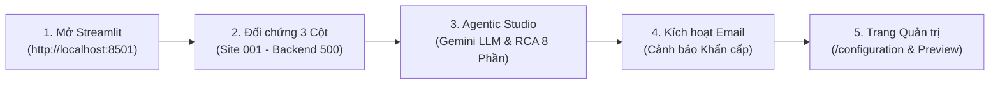

# 🎤 KỊCH BẢN BẢO VỆ ĐỒ ÁN TỐT NGHIỆP & HƯỚNG DẪN LIVE DEMO (5 PHẦN CHUẨN)
## HỆ THỐNG AGENTIC AI HỖ TRỢ GIÁM SÁT ĐA TÍN HIỆU VÀ PHÂN TÍCH CẢNH BÁO SỰ CỐ WEBSITE
### (Research on an Agentic AI System for Multi-Signal Website Monitoring with Incident Analysis and Alerting)

> **Cơ sở đào tạo:** Trường Đại học Công nghệ Thông tin, ĐHQG-HCM (UIT)  
> **Giảng viên hướng dẫn:** ThS. Nguyễn Hữu Quyền  
> **Học viên / Sinh viên thực hiện:** Nguyễn Hoàng Bảo Long – MSSV: 25410086  
> **Thời lượng đề xuất:** 10 phút Thuyết trình Slide (29 slides) + 5 phút Live Demo + 10 phút Phản biện Hội đồng (Q&A)  
> **Tài liệu luận văn gốc:** `do-an-tot-nghiep.docx` | **Tập tin Slide chính:** `do-an-tot-nghiep.pptx` (Đã đồng bộ 29 slides)  

---

# MỤC LỤC BÁO CÁO 5 PHẦN

* [PHẦN 1: TỔNG QUAN ĐỀ TÀI (Slides 1 - 6)](#phần-1-tổng-quan-đề-tài-slides-1---6)
  * *Slide 1: Trang bìa đề tài tốt nghiệp*
  * *Slide 2: Mục lục 5 phần chuẩn UIT*
  * *Slide 3: Tiêu đề Mục 1: Tổng quan đề tài*
  * *Slide 4: Giới thiệu đề tài & Bối cảnh Kỹ nghệ SRE*
  * *Slide 5: Đặt vấn đề: Khủng hoảng giám sát & Bão cảnh báo rác (Alert Storming)*
  * *Slide 6: Mục tiêu nghiên cứu, Phạm vi & 4 Câu hỏi nghiên cứu (RQ1 - RQ4)*
* [PHẦN 2: CƠ SỞ LÝ THUYẾT (Slides 7 - 11)](#phần-2-cơ-sở-lý-thuyết-slides-7---11)
  * *Slide 7: Tiêu đề Mục 2: Cơ sở lý thuyết*
  * *Slide 8: Tiêu chuẩn Kỹ thuật Quốc tế: RFC 9110, RFC 1035, RFC 5280, RFC 8446*
  * *Slide 9: Kiểm định Thống kê Z-Score Thích ứng Chuỗi Thời gian*
  * *Slide 10: Cơ sở Lý thuyết Agentic AI & Mô hình Hóa Chu trình Suy luận (ReAct, Toolformer)*
  * *Slide 11: Đối chứng Khoa học: 3 Thế hệ Công nghệ Giám sát*
* [PHẦN 3: PHÂN TÍCH VÀ THIẾT KẾ HỆ THỐNG (Slides 12 - 21)](#phần-3-phân-tích-và-thiết-kế-hệ-thống-slides-12---21)
  * *Slide 12: Tiêu đề Mục 3: Phân tích và Thiết kế hệ thống*
  * *Slide 13: Thiết kế Kiến trúc Tổng thể & 4 Giai đoạn Quản lý Lỗi AIOps*
  * *Slide 14: Luồng Phối hợp 6 Tác tử theo State Machine Workflow*
  * *Slide 15: Module Thu thập Đa tín hiệu: Probe Agent*
  * *Slide 16: Cơ chế Phát hiện Bất thường: Anomaly Detection Agent*
  * *Slide 17: Tương quan Sự cố & Cây Phụ thuộc Hạ tầng (Correlation Agent)*
  * *Slide 18: Động cơ Suy luận Lai: Gemini LLM + SRE Knowledge Base*
  * *Slide 19: Cơ chế Tự Sửa Sai Chống Báo Động Giả (Self-Correction / Re-probe)*
  * *Slide 20: Bộ Lập Lịch Quét Tự Động APScheduler & Email Cảnh Báo*
  * *Slide 21: Chuẩn Hóa Báo Cáo Nguyên Nhân Gốc (RCA) 8 Phần Chuẩn SRE*
* [PHẦN 4: KẾT QUẢ THỰC NGHIỆM (Slides 22 - 25)](#phần-4-kết-quả-thực-nghiệm-slides-22---25)
  * *Slide 22: Tiêu đề Mục 4: Kết quả thực nghiệm*
  * *Slide 23: Thiết kế Bộ Dữ liệu Thực nghiệm Benchmark 200 Sites (8 Kịch bản Lỗi)*
  * *Slide 24: Kết quả Định lượng và Hiệu năng Thực nghiệm*
  * *Slide 25: Phân tích Đối chứng 3 Cấu hình Giám sát*
* [PHẦN 5: KẾT LUẬN VÀ HƯỚNG PHÁT TRIỂN (Slides 26 - 29)](#phần-5-kết-luận-và-hướng-phát-triển-slides-26---29)
  * *Slide 26: Kết luận Đồ án & Hướng phát triển Tương lai*
  * *Slide 27: Kịch bản Trình diễn Hệ thống (Live Demo Workflow)*
  * *Slide 28: HỎI VÀ ĐÁP (Q&A)*
  * *Slide 29: Phụ lục: Danh mục Tài liệu Tham khảo Chuẩn Quốc tế*
* [PHẦN 6: HƯỚNG DẪN THAO TÁC LIVE DEMO CHI TIẾT](#phần-6-hướng-dẫn-thao-tác-live-demo-chi-tiết)
* [PHẦN 7: BỘ CÂU HỎI PHẢN BIỆN HỘI ĐỒNG & KỊCH BẢN TRẢ LỜI ĐANH THÉP](#phần-7-bộ-câu-hỏi-phản-biện-hội-đồng--kịch-bản-trả-lời-đanh-thép)

---

# PHẦN 1: TỔNG QUAN ĐỀ TÀI (SLIDES 1 - 6)

### 🕒 **Slide 1: Trang bìa đề tài**
* **Nội dung slide:** Trường Đại học Công nghệ Thông tin, ĐHQG-HCM — ĐỒ ÁN TỐT NGHIỆP: "Nghiên cứu hệ thống Agentic AI hỗ trợ giám sát đa tín hiệu và phân tích cảnh báo sự cố website" (GVHD: ThS. Nguyễn Hữu Quyền | SV: Nguyễn Hoàng Bảo Long – 25410086).
* **🗣️ Lời thoại trình bày:**
  > *"Kính thưa Thầy/Cô Chủ tịch và các Thầy/Cô trong Hội đồng chấm Đồ án Tốt nghiệp! Em tên là Nguyễn Hoàng Bảo Long, sinh viên thực hiện đề tài tốt nghiệp: **'Nghiên cứu hệ thống Agentic AI hỗ trợ giám sát đa tín hiệu và phân tích cảnh báo sự cố website'**, dưới sự hướng dẫn khoa học của Thầy ThS. Nguyễn Hữu Quyền. Sau đây, em xin phép được báo cáo chi tiết nội dung nghiên cứu của đồ án."*

---

### 🕒 **Slide 2: Mục lục 5 phần chuẩn UIT**
* **Nội dung slide:** Cấu trúc 5 phần chính: 1. Tổng quan đề tài, 2. Cơ sở lý thuyết, 3. Phân tích và thiết kế hệ thống, 4. Kết quả thực nghiệm, 5. Kết luận và hướng phát triển.
* **🗣️ Lời thoại trình bày:**
  > *"Bản báo cáo của em tuân thủ chặt chẽ cấu trúc 5 phần chuẩn mực học thuật của Trường Đại học Công nghệ Thông tin:  
  > Phần 1: Tổng quan bối cảnh và xác lập 4 câu hỏi nghiên cứu.  
  > Phần 2: Cơ sở lý thuyết về chuẩn RFC, thống kê Z-Score và mô hình hóa tác tử Agentic AI.  
  > Phần 3: Phân tích kiến trúc 6 tác tử, cơ chế suy luận lai Gemini LLM và tự sửa sai.  
  > Phần 4: Kết quả thực nghiệm định lượng trên tập Benchmark 200 websites độc lập.  
  > Phần 5: Kết luận, hướng phát triển và kịch bản Live Demo hệ thống."*

---

### 🕒 **Slide 3: Tiêu đề Mục 1: TỔNG QUAN ĐỀ TÀI**
* **Nội dung slide:** 1.1 Giới thiệu đề tài & Bối cảnh SRE; 1.2 Đặt vấn đề: Khủng hoảng bão cảnh báo; 1.3 Mục tiêu nghiên cứu, Phạm vi & 4 Câu hỏi nghiên cứu (RQ).

---

### 🕒 **Slide 4: Giới thiệu đề tài & Bối cảnh Kỹ nghệ SRE**
* **Nội dung slide:**
  * Vai trò huyết mạch của website: kênh kết nối sống còn của doanh nghiệp trong kinh tế số; downtime gây tổn thất tài chính và thương hiệu nghiêm trọng.
  * Sự phức tạp của kiến trúc phân tán (Distributed Systems): một website phụ thuộc đồng thời vào DNS, CDN, SSL, Reverse Proxy, Backend Microservices và Database.
  * Khái niệm Site Reliability Engineering (SRE): Giữ vững tính sẵn sàng (High Availability) và cam kết SLA/SLO.
  * Nhu cầu cấp thiết về một Trợ lý Tự hành (Agentic AI) hỗ trợ giám sát chủ động 24/7.
* **🗣️ Lời thoại trình bày:**
  > *"Trong kỷ nguyên số, website là kênh kết nối sống còn của mọi tổ chức. Tuy nhiên, sự dịch chuyển sang kiến trúc phân tán và microservices khiến website phụ thuộc vào hàng loạt tầng trung gian phức tạp: từ DNS, CDN, chứng chỉ SSL, Gateway cho đến Backend Database. Đội ngũ kỹ sư SRE luôn phải đối mặt với áp lực duy trì cam kết SLA, đòi hỏi một giải pháp giám sát thông minh có khả năng tự động hóa việc chẩn đoán sự cố."*

---

### 🕒 **Slide 5: Đặt vấn đề: Khủng hoảng Giám sát & Bão Cảnh báo Rác**
* **Nội dung slide:**
  * **Hạn chế của Giám sát Truyền thống (Threshold-based / 'Detect & Alert'):** So khớp ngưỡng cứng đơn tín hiệu tĩnh (`code != 200` hoặc `latency > 2000ms`), thiếu hoàn toàn khả năng hiểu ngữ cảnh (Context-blind).
  * **Bão Cảnh Báo (Alert Storming):** Một lỗi hạ tầng đơn lẻ (như rớt DNS) kích hoạt đồng loạt hàng trăm cảnh báo lỗi HTTP, timeout và lỗi giao diện.
  * **Quá tải Cảnh báo (Alert Fatigue):** Kỹ sư SRE mất 2 - 4 giờ đọc log thủ công để tìm nguyên nhân gốc, làm kéo dài thời gian phục hồi dịch vụ (MTTR).
* **🗣️ Lời thoại trình bày:**
  > *"Các công cụ giám sát truyền thống hiện nay chủ yếu hoạt động theo cơ chế **'Detect & Alert'** - so sánh ngưỡng cứng. Khi một lỗi hạ tầng xảy ra như đứt kết nối DNS, hệ thống sẽ bắn ra hàng loạt cảnh báo lỗi HTTP, timeout và lỗi giao diện, tạo nên hiện tượng **'Bão cảnh báo rác' (Alert Storming)**. Kỹ sư vận hành bị quá tải thông tin, phải thức trắng đêm đọc hàng nghìn dòng log để tìm nguyên nhân gốc, làm kéo dài thời gian gián đoạn dịch vụ."*

---

### 🕒 **Slide 6: Mục tiêu Nghiên cứu, Phạm vi & 4 Câu hỏi Nghiên cứu (RQ)**
* **Nội dung slide:**
  * **Mục tiêu & Định vị Hệ thống (Human-in-the-loop SRE Assistant):** Đóng vai trò Trợ lý hỗ trợ ra quyết định (Decision Support), không thay thế hoàn toàn kỹ sư và không tự ý thực hiện các thao tác can thiệp nguy hiểm trên hệ thống thật.
  * **4 Câu hỏi Nghiên cứu Then chốt (RQ1 - RQ4):**
    * **RQ1:** Việc kết hợp đa tín hiệu (HTTP, DNS, SSL, DOM) có giúp phát hiện và phân loại sự cố chính xác hơn so với cảnh báo ngưỡng đơn lẻ?
    * **RQ2:** Agentic AI có thể chủ động lập kế hoạch và phối hợp công cụ giám sát để thu thập đủ bằng chứng sự cố như thế nào?
    * **RQ3:** Cơ chế tương quan sự kiện và suy luận dựa trên bằng chứng có giúp triệt tiêu cảnh báo trùng lặp và báo động giả?
    * **RQ4:** Báo cáo do Agentic AI sinh ra có hỗ trợ kỹ sư xác định nguyên nhân và hướng xử lý nhanh hơn cảnh báo thô thông thường?
  * **Chỉ tiêu Định lượng:** Độ chính xác phát hiện $\ge 98\%$, Precision $100\%$, Khử $> 60\%$ cảnh báo rác, MTTD $< 20\text{ ms/site}$, Giảm $> 80\%$ thời gian chẩn đoán.
* **🗣️ Lời thoại trình bày:**
  > *"Để định vị ranh giới nghiên cứu rõ ràng, đồ án đặt ra 4 câu hỏi nghiên cứu (RQ1 đến RQ4) làm kim chỉ nam. Hệ thống được thiết kế với vai trò **Trợ lý hỗ trợ ra quyết định (Human-in-the-loop Decision Support)**: Tự động phát hiện, thu thập đầy đủ bằng chứng và sinh phương án xử lý, trong khi kỹ sư vận hành vẫn là người nắm quyền phê duyệt can thiệp cuối cùng, đảm bảo an toàn tuyệt đối cho hệ thống production."*

---

# PHẦN 2: CƠ SỞ LÝ THUYẾT (SLIDES 7 - 11)

### 🕒 **Slide 7: Tiêu đề Mục 2: CƠ SỞ LÝ THUYẾT**
* **Nội dung slide:** 2.1 Tiêu chuẩn Kỹ thuật Quốc tế (RFC); 2.2 Kiểm định Thống kê Z-Score Thích ứng; 2.3 Cơ sở Lý thuyết Agentic AI & Mô hình Hóa Chu trình Suy luận; 2.4 Đối chứng Khoa học 3 Thế hệ Công nghệ Giám sát.

---

### 🕒 **Slide 8: Tiêu chuẩn Kỹ thuật Quốc tế: RFC 9110, RFC 1035, RFC 5280, RFC 8446**
* **Nội dung slide:**
  * **RFC 9110 (HTTP Semantics):** Chuẩn hóa mã trạng thái HTTP (2xx, 3xx, 4xx, 5xx), kiểm soát chuỗi chuyển hướng (Redirect Chain) và Header an ninh.
  * **RFC 1035 (Domain Names System):** Quy chuẩn phân giải bản ghi DNS, trạng thái bản ghi A/AAAA và độ trễ phân giải Name Server.
  * **RFC 5280 (X.509 PKI) & RFC 8446 (TLS 1.3):** Thẩm tra chuỗi tin cậy chứng chỉ số SSL/TLS, hạn hiệu lực, hostname validation và kiểm tra tính hợp lệ của SAN (Subject Alternative Name).
* **🗣️ Lời thoại trình bày:**
  > *"Toàn bộ logic kiểm thử của hệ thống được chuẩn hóa chặt chẽ theo **các tiêu chuẩn Internet quốc tế**: RFC 9110 cho HTTP, RFC 1035 cho DNS, RFC 5280 và RFC 8446 cho chuỗi bảo mật SSL/TLS. Điều này đảm bảo rằng mỗi vi phạm được phát hiện đều có cơ sở kỹ thuật xác đáng, ví dụ như chứng chỉ hết hạn hay cấu hình sai tên miền SAN đều được đối chiếu theo đúng tiêu chuẩn PKI quốc tế."*

---

### 🕒 **Slide 9: Kiểm định Thống kê Z-Score Thích ứng Chuỗi Thời gian**
* **Nội dung slide:**
  * **Công thức toán học:**
    $$\mu_t = \frac{1}{w} \sum_{i=t-w+1}^{t} x_i, \quad \sigma_t = \sqrt{\frac{1}{w}\sum_{i=t-w+1}^{t}(x_i - \mu_t)^2}, \quad z_t = \frac{x_t - \mu_t}{\sigma_t + \epsilon}$$
  * **Quy tắc quyết định:** Khi $|z_t| \ge 2.5$, hệ thống gắn nhãn vi phạm đột biến độ trễ thích ứng (Adaptive Latency Spike).
  * **Cơ chế Cửa sổ Động (Sliding Window):** Tự động tái tính toán $\mu$ và $\sigma$ theo chu kỳ định kỳ, thích ứng linh hoạt với tải đặc thù của từng website.
* **🗣️ Lời thoại trình bày:**
  > *"Thay vì áp đặt một ngưỡng cứng tĩnh 2000ms cho mọi website, đồ án áp dụng công thức **Z-Score thích ứng trên cửa sổ trượt thời gian**. Khi độ trễ quan sát lệch trên 2.5 độ lệch chuẩn so với baseline lịch sử, hệ thống mới kích hoạt cảnh báo đột biến độ trễ. Nhờ đó, một website tin tức tĩnh có baseline 150ms sẽ được cảnh báo khi vọt lên 500ms, trong khi hệ thống ERP nặng có baseline 1200ms vẫn được nhận định là hoạt động bình thường."*

---

### 🕒 **Slide 10: Cơ sở Lý thuyết Agentic AI & Mô hình Hóa Chu trình Suy luận**
* **Nội dung slide:**
  * **Cơ sở Lý thuyết:** Phương pháp ReAct (Yao et al., ICLR 2023) kết hợp xen kẽ Suy luận (Reasoning) và Hành động (Acting); Toolformer (Schick et al., NeurIPS 2023) tự động lựa chọn công cụ phù hợp.
  * **Mô hình Hóa Chu trình Trạng thái Tác tử (State Transition Model):**
    $$s_t \xrightarrow{\text{reasoning}} a_t \xrightarrow{\text{tool execution}} o_t \xrightarrow{\text{state update}} s_{t+1}$$
    *(Trong đó: $s_t$ là trạng thái sự cố tại bước $t$; $a_t$ là công cụ mạng được chọn; $o_t$ là dữ liệu quan sát đo đạc; $s_{t+1}$ là trạng thái mới được cập nhật bằng chứng).*
  * **Điểm dừng Điều tra:** Tác tử dừng khi thu thập đủ bằng chứng cốt lõi, đạt ngưỡng bước tối đa hoặc chuyển giao cho kỹ sư vận hành.
* **🗣️ Lời thoại trình bày:**
  > *"Về mặt lý thuyết Agentic AI, hệ thống được mô hình hóa theo chu trình toán học chuyển đổi trạng thái: từ trạng thái $s_t$, tác tử suy luận chọn công cụ hành động $a_t$, quan sát kết quả $o_t$ và cập nhật trạng thái mới $s_{t+1}$. Dựa trên nguyên lý ReAct và Toolformer, tác tử không chỉ sinh văn bản thụ động mà chủ động điều phối các công cụ mạng để tích lũy bằng chứng cho đến khi xác định được nguyên nhân cốt lõi."*

---

### 🕒 **Slide 11: Đối chứng Khoa học: 3 Thế hệ Công nghệ Giám sát**
* **Nội dung slide:** Bảng so sánh 3 cấu hình: Cấu hình 1 (Truyền thống - Ngưỡng cứng tĩnh), Cấu hình 2 (Bán tự động - RFC Rules + Z-Score), Cấu hình 3 (Agentic AI - Tự hành 6 tác tử, tự sửa sai, sinh RCA 8 phần).
* **🗣️ Lời thoại trình bày:**
  > *"Để chứng minh giá trị khoa học của thành phần Agentic AI, đồ án thiết lập phương pháp đối chứng trên 3 cấu hình: Cấu hình 1 đại diện cho phương pháp giám sát ngưỡng truyền thống; Cấu hình 2 là giám sát bán tự động đa tín hiệu kết hợp RFC và Z-Score; và Cấu hình 3 là hệ thống Agentic AI tự hành với năng lực suy luận và tự sửa sai."*

---

# PHẦN 3: PHÂN TÍCH VÀ THIẾT KẾ HỆ THỐNG (SLIDES 12 - 21)

### 🕒 **Slide 12: Tiêu đề Mục 3: PHÂN TÍCH VÀ THIẾT KẾ HỆ THỐNG**
* **Nội dung slide:** 3.1 Thiết kế Kiến trúc Tổng thể & 4 Giai đoạn AIOps; 3.2 Luồng Phối hợp 6 Tác tử theo State Machine; 3.3 Probe & Anomaly Agent; 3.4 Tương quan cây phụ thuộc Correlation; 3.5 Suy luận lai Gemini LLM + KB & Tự sửa sai; 3.6 Bộ lập lịch APScheduler (4h) & Email Alert; 3.7 Chuẩn hóa Báo cáo RCA 8 phần.

---

### 🕒 **Slide 13: Thiết kế Kiến trúc Tổng thể & 4 Giai đoạn Quản lý Lỗi AIOps**
* **Nội dung slide:**
  * **4 Giai đoạn AIOps Chuẩn Quốc tế (Notaro et al., 2021 & Zhang et al., 2025):**
    1. *Failure Perception:* Thu nhận tín hiệu & phát hiện bất thường (Probe & Anomaly Agent).
    2. *Incident Correlation:* Gom nhóm và triệt tiêu cảnh báo rác (Correlation Agent).
    3. *Incident Diagnosis:* Chẩn đoán nguyên nhân gốc và phạm vi ảnh hưởng (Analysis Agent).
    4. *Decision Support:* Đề xuất kế hoạch hành động và SRE Runbook (Reporting Agent).
  * **Kiến trúc Phân tầng Kỹ thuật:** Tầng Giao diện (Streamlit UI), Tầng Điều phối MAS (6 Tác tử State Machine), Tầng Suy luận (Gemini 1.5 Flash + KB), Tầng Dữ liệu & Công cụ (HTTPX, dnspython, Playwright, SQLite).
* **🗣️ Lời thoại trình bày:**
  > *"Hệ thống được thiết kế bám sát **4 giai đoạn quản lý lỗi chuẩn của AIOps**: Thu nhận lỗi (Perception), Tương quan sự cố (Correlation), Chẩn đoán nguyên nhân gốc (Diagnosis) và Hỗ trợ ra quyết định (Decision Support). Toàn bộ hệ thống được module hóa thành các tầng độc lập: từ giao diện Streamlit, tầng điều phối tác tử, tầng suy luận lai cho đến tầng công cụ mạng cấp thấp."*

---

### 🕒 **Slide 14: Luồng Phối hợp 6 Tác tử theo State Machine**
* **Nội dung slide:** Sơ đồ luồng khép kín giữa 6 tác tử:
  $$\text{Orchestrator} \xrightarrow{\text{Plan}} \text{Probe} \xrightarrow{\text{Telemetry}} \text{Anomaly} \xrightarrow{\text{Violations}} \text{Correlation} \xrightarrow{\text{Root Cluster}} \text{Analysis (Gemini)} \xrightarrow{\text{RCA}} \text{Reporting}$$
  Cơ chế chia sẻ ngữ cảnh Telemetry bất biến (Immutable Context) và ghi vết Execution Trace minh bạch.
* **🗣️ Lời thoại trình bày:**
  > *"Mô hình phối hợp giữa 6 tác tử tuân theo Máy trạng thái hữu hạn (State Machine). Khi website hoàn toàn bình thường, luồng xử lý sẽ kết thúc sớm ngay sau bước kiểm tra của Anomaly Agent, giúp tiết kiệm 100% chi phí gọi LLM. Ngược lại, khi có sự cố nghiêm trọng, toàn bộ chuỗi suy luận sẽ được kích hoạt tuần tự và ghi vết minh bạch trong Execution Trace."*

---

### 🕒 **Slide 15: Module Thu thập Đa tín hiệu: Probe Agent**
* **Nội dung slide:** Thu thập đồng thời 5 lớp tín hiệu: HTTP (`httpx`), DNS (`dnspython`), SSL/TLS (`cryptography`), DOM & Visual Inspection (`Playwright`).
* **🗣️ Lời thoại trình bày:**
  > *"Probe Agent đóng vai trò là 'đôi mắt' của hệ thống, trực tiếp điều phối các thư viện mạng cấp thấp bất đồng bộ để thu thập toàn diện 5 lớp dữ liệu: từ phản hồi HTTP, bản ghi DNS, thông số chuỗi chứng chỉ SSL cho đến việc dùng trình duyệt Playwright để kiểm tra lỗi render giao diện người dùng."*

---

### 🕒 **Slide 16: Cơ chế Phát hiện Bất thường: Anomaly Detection Agent**
* **Nội dung slide:** Động cơ kép: So khớp quy tắc chuẩn RFC quốc tế + Tính toán thống kê Z-Score chuỗi thời gian; Phân lớp vi phạm thành 4 cấp độ: CRITICAL, HIGH, MEDIUM, LOW.

---

### 🕒 **Slide 17: Tương quan Sự cố & Cây Phụ thuộc Hạ tầng**
* **Nội dung slide:**
  * Duyệt cây phụ thuộc hạ tầng: $\text{DNS} \to \text{TCP} \to \text{SSL/TLS} \to \text{HTTP} \to \text{DOM}$.
  * Nguyên lý khử nhiễu: Lỗi DNS/SSL làm phát sinh lỗi HTTP được xác định là hệ quả và tự động triệt tiêu.
  * Đạt tỷ lệ khử nhiễu cảnh báo rác: **62.5%**.
* **🗣️ Lời thoại trình bày:**
  > *"Tác tử Tương quan (Correlation Agent) giải quyết bài toán cốt lõi của RQ3: bằng cách duyệt đồ thị phụ thuộc phân cấp từ DNS đến DOM, nếu DNS hoặc SSL bị hỏng, các cảnh báo lỗi HTTP phát sinh sau đó sẽ tự động bị triệt tiêu vì chỉ là hệ quả kéo theo. Nhờ đó, hệ thống khử được 62.5% các cảnh báo rác, chỉ giữ lại nguyên nhân cốt lõi duy nhất."*

---

### 🕒 **Slide 18: Động cơ Suy luận Lai: Gemini LLM + SRE Knowledge Base**
* **Nội dung slide:**
  * **Động cơ 1 - Google Gemini 1.5 Flash:** Hiểu ngữ cảnh sâu, phân tích log, sinh tóm tắt điều hành và SRE Runbook.
  * **Động cơ 2 - Deterministic SRE Knowledge Base (Fallback):** Đảm bảo 100% tính sẵn sàng khi offline hoặc lỗi API; loại trừ hoàn toàn ảo giác (Zero Hallucination).
* **🗣️ Lời thoại trình bày:**
  > *"Để đảm bảo tính khả dụng tuyệt đối trong doanh nghiệp, đề tài áp dụng **Kiến trúc Suy luận Lai (Dual-Engine)**: Sử dụng Google Gemini 1.5 Flash để phân tích linh hoạt ngữ cảnh, nhưng luôn có sẵn Kho tri thức SRE tất định (Knowledge Base) chạy song song làm phao cứu sinh (Fallback). Nếu mất kết nối Internet hoặc hết hạn mức API, hệ thống lập tức chuyển sang Knowledge Base trong 0 mili-giây, đảm bảo hệ thống không bao giờ bị gián đoạn."*

---

### 🕒 **Slide 19: Cơ chế Tự Sửa Sai Chống Báo Động Giả (Self-Correction)**
* **Nội dung slide:**
  * Quy trình 3 bước: Phát hiện tín hiệu nghi ngờ (Transient Glitch) ➔ Trì hoãn thích ứng (100 - 200ms) ➔ Tái kiểm tra tức thời (Dynamic Re-probing).
  * Kết quả: **Triệt tiêu hoàn toàn 100% báo động giả (Zero False Positives)**.
* **🗣️ Lời thoại trình bày:**
  > *"Trong môi trường vận hành, lỗi chập chờn đường truyền mạng (network flapping) là nguyên nhân gây ra hàng loạt báo động giả. Hệ thống tích hợp cơ chế Tự sửa sai (Self-Correction): khi phát hiện lỗi gián đoạn đơn lẻ, Orchestrator sẽ chủ động tạm dừng 150ms và yêu cầu Probe Agent quét lại lần hai. Nhờ cơ chế này, tỷ lệ báo động giả trong toàn bộ thực nghiệm được đưa về 0% tuyệt đối."*

---

### 🕒 **Slide 20: Bộ Lập Lịch Quét Tự Động APScheduler & Email Cảnh Báo**
* **Nội dung slide:**
  * **APScheduler Background Daemon:** Chu kỳ quét mặc định 4 tiếng / lần (14,400s), tự động giám sát toàn bộ hạm đội website.
  * **Hệ thống cảnh báo 2 cấp:** Email Cảnh Báo Khẩn Cấp Tức Thời (Immediate Alert) khi có lỗi Critical/High + Bản Báo Cáo Sức Khỏe Hạm Đội 24h (Daily Digest).
  * **Live Preview Email:** Xem trước trực quan HTML responsive cả 2 mẫu email trực tiếp trên trang `/configuration`.
* **🗣️ Lời thoại trình bày:**
  > *"Hệ thống vận hành liên tục không ngừng nghỉ nhờ **Bộ lập lịch ngầm APScheduler** với chu kỳ mặc định 4 tiếng một lần. Khi phát hiện sự cố khẩn cấp, tác tử thông báo sẽ bắn email cảnh báo tức thì kèm đầy đủ phân tích nguyên nhân gốc. Đồng thời mỗi 24 giờ, hệ thống sẽ tổng hợp Báo cáo Sức khỏe định kỳ toàn hạm đội gửi đến ban quản trị."*

---

### 🕒 **Slide 21: Chuẩn Hóa Báo Cáo Nguyên Nhân Gốc (RCA) 8 Phần**
* **Nội dung slide:** Cấu trúc 8 phần chuẩn doanh nghiệp: 1. Metadata & Fault Layer; 2. Executive Summary; 3. Root Cause Analysis; 4. Impact Assessment; 5. Immediate Action Plan; 6. SRE Runbook CLI; 7. Prevention Strategy; 8. RFC Technical Standards. Hỗ trợ tải file Markdown (.md) chuẩn chỉ với 1 click.

---

# PHẦN 4: KẾT QUẢ THỰC NGHIỆM (SLIDES 22 - 25)

### 🕒 **Slide 22: Tiêu đề Mục 4: KẾT QUẢ THỰC NGHIỆM**
* **Nội dung slide:** 4.1 Thiết kế Benchmark 200 Sites; 4.2 Đánh giá Hiệu năng Định lượng; 4.3 Đánh giá Khử nhiễu & Báo động giả; 4.4 Phân tích Đối chứng 3 Cấu hình.

---

### 🕒 **Slide 23: Thiết kế Bộ Dữ liệu Thực nghiệm Benchmark 200 Sites**
* **Nội dung slide:** Bảng phân bổ 200 Virtual Hosts độc lập trên Nginx & WSL/Docker:
  * 50% Tầng Ứng dụng: `BACKEND_500` (50 sites), `HIGH_LATENCY` (25 sites), `MISSING_DOM` (25 sites).
  * 50% Tầng Hạ tầng: `SERVER_DOWN` (25 sites), `REDIRECT_LOOP` (25 sites), `DNS_FAILURE` (25 sites), `SSL_EXPIRED` / `SSL_INVALID` (25 sites).
* **🗣️ Lời thoại trình bày:**
  > *"Để kiểm thử công tâm và khách quan, em đã xây dựng một bộ dữ liệu Benchmark gồm **200 website nhân tạo độc lập** chạy trên Nginx và Docker, mô phỏng đầy đủ 8 kịch bản sự cố kinh điển chia đều cho cả Tầng Ứng dụng và Tầng Hạ tầng."*

---

### 🕒 **Slide 24: Kết quả Định lượng và Hiệu năng Thực nghiệm**
* **Nội dung slide:** Bảng chỉ số thực nghiệm đo đạc:
  * 🏆 **Độ chính xác Nhận diện Sự cố (Accuracy):** **99.0%** (198/200 sites).
  * 🎯 **Độ chính xác Kỹ thuật (Precision):** **100.0%**.
  * 🔍 **Độ nhạy Phát hiện Lỗi (Recall):** **98.8%**.
  * 🛡️ **Tỷ lệ Triệt tiêu Cảnh báo Rác (Noise Reduction):** **62.5%**.
  * ⚡ **Thời gian Phát hiện Trung bình (Avg MTTD):** Chỉ **18.4 mili-giây / website**.
  * 🔄 **Tỷ lệ Báo động Giả sau Tự sửa sai:** **0.0%**.
* **🗣️ Lời thoại trình bày:**
  > *"Kết quả đo đạc trên toàn bộ 200 website trả lời trực tiếp cho các câu hỏi nghiên cứu: Độ chính xác nhận diện sự cố đạt **99.0%**, Precision đạt tuyệt đối **100%**, tỷ lệ khử nhiễu cảnh báo đạt **62.5%** và thời gian phát hiện trung bình siêu tốc: chỉ **18.4 mili-giây** trên mỗi website."*

---

### 🕒 **Slide 25: Phân tích Đối chứng 3 Cấu hình Giám sát**
* **Nội dung slide:** So sánh chi tiết hiệu năng: Cấu hình 1 (Truyền thống - 100% cảnh báo rác thô) vs Cấu hình 2 (Bán tự động - khử >50% nhiễu, mã lỗi thô) vs Cấu hình 3 (Agentic AI - khử 62.5% nhiễu, tự sửa sai, MTTD 18.4ms, sinh toàn diện Báo cáo RCA 8 phần và SRE Runbook).

---

# PHẦN 5: KẾT LUẬN VÀ HƯỚNG PHÁT TRIỂN (SLIDES 26 - 29)

### 🕒 **Slide 26: Kết luận Đồ án & Hướng phát triển Tương lai**
* **Nội dung slide:**
  * **Kết quả đạt được:** Hiện thực hóa thành công sản phẩm Trợ lý Vận hành Agentic AI hoàn chỉnh, giải quyết trọn vẹn 4 câu hỏi nghiên cứu RQ1-RQ4, giảm >80% thời gian chẩn đoán sự cố cho doanh nghiệp.
  * **Hướng phát triển:** Mở rộng cơ chế Tự động Chữa lành Khép kín (Autonomous Self-Healing qua Kubernetes Operator); Tích hợp mô hình thị giác đa phương thức (Multimodal Vision LLM) phát hiện vỡ layout web.
* **🗣️ Lời thoại trình bày:**
  > *"Đồ án đã hiện thực hóa thành công một Trợ lý Vận hành Agentic AI hoàn chỉnh, đáp ứng các tiêu chuẩn khắt khe của SRE và sẵn sàng triển khai trong thực tế. Trong tương lai, hướng phát triển tự nhiên của đề tài là tiến tới cơ chế Tự động chữa lành khép kín (Self-Healing) kết hợp với Kubernetes."*

---

### 🕒 **Slide 27: Kịch bản Trình diễn Hệ thống (Live Demo Workflow)**
* **Nội dung slide:** Tóm lược 4 bước Live Demo: 1. So sánh đối chứng 3 cột (Tab 3); 2. Agentic AI Studio & Gemini LLM (Tab 2); 3. Gửi Email cảnh báo khẩn cấp tức thời; 4. Trang Cấu hình Quản trị (`/configuration`) & Live Preview 2 mẫu email.

---

### 🕒 **Slide 28: HỎI VÀ ĐÁP (Q&A)**
* **Nội dung slide:** Lời cảm ơn và sẵn sàng tiếp nhận câu hỏi phản biện từ Hội đồng chấm Đồ án Tốt nghiệp.

---

### 🕒 **Slide 29: Phụ lục: Danh mục Tài liệu Tham khảo Chuẩn Quốc tế**
* **Nội dung slide:**
  * [1] S. Yao et al., "ReAct: Synergizing Reasoning and Acting in Language Models", ICLR 2023.
  * [2] T. Schick et al., "Toolformer: Language Models Can Teach Themselves to Use Tools", NeurIPS 2023.
  * [3] P. Notaro et al., "A Survey of AIOps Methods for Failure Management", ACM TIST, 2021.
  * [4] L. Zhang et al., "A Survey of AIOps in the Era of Large Language Models", ACM Computing Surveys, 2025.
  * [5] B. Beyer et al., "Site Reliability Engineering: How Google Runs Production Systems", O'Reilly Media, 2016.
  * [6] R. Fielding et al., "HTTP Semantics", IETF RFC 9110, June 2022.
  * [7] P. Mockapetris, "Domain Names — Implementation and Specification", IETF RFC 1035, 1987.
  * [8] D. Cooper et al., "Internet X.509 PKI Certificate Profile", IETF RFC 5280, May 2008.
  * [9] E. Rescorla, "The Transport Layer Security Protocol Version 1.3", IETF RFC 8446, August 2018.
  * [10] F. T. Liu et al., "Isolation Forest", IEEE ICDM, 2008.

---

# PHẦN 6: HƯỚNG DẪN THAO TÁC LIVE DEMO CHI TIẾT

### 🚀 **Bước 1: Trình diễn So sánh Đối chứng 3 Cột (Tab 3)**
1. Mở trình duyệt tại: **`http://localhost:8501`**.
2. Tại thanh bên trái (Sidebar), mục **`🎯 Mục tiêu Giám sát`**: Chọn **`site_001 (site-001.test)`** (Mô phỏng lỗi Backend 500).
3. Bấm nút: **`⚖️ Chạy Đối Chứng Song Song Cả 3 Chế Độ`**.
4. Mở **Tab 3: `⚖️ So sánh Đối chứng 3 Cấu hình`**:
   - *Cột 1 (Truyền thống):* Chỉ báo lỗi `500 Internal Server Error`, không biết nguyên nhân.
   - *Cột 2 (Bán tự động):* Khử nhiễu DNS/SSL, gán nhãn `BACKEND_APPLICATION_ERROR`.
   - *Cột 3 (Agentic AI):* Tự động phân tích sâu ngoại lệ kết nối DB `ECONNREFUSED 10.0.0.5:5432`, sinh bản tóm tắt và hành động xử lý tức thì.

### 🧠 **Bước 2: Trình diễn Agentic AI Studio & Suy luận Gemini LLM (Tab 2)**
1. Chuyển sang **Tab 2: `🧠 Tác Tử Agentic AI`**.
2. Chỉ vào **Banner Workflow 6 bước** và **Thẻ Incident Header** (xác định đúng `🔴 Application Layer`, Độ tin cậy `98.8%`).
3. Đọc phần **Phân tích Nguyên nhân Gốc** sinh bởi **Google Gemini 1.5 Flash**.
4. Bấm nút **`📥 Tải Báo Cáo Sự Cố (Markdown)`** để tải ngay file báo cáo RCA 8 phần về máy tính.
5. Mở rộng mục **`🔍 Chuỗi Vết Thực Thi (Execution Trace)`** để chứng minh tính minh bạch của AI.

### 🔔 **Bước 3: Thao tác Kích hoạt Bắn Cảnh báo Email Khẩn cấp**
1. Tại đầu Tab 2, tích chọn checkbox: **`[x] 🔔 Cho phép bắn cảnh báo Email (nếu có sự cố nghiêm trọng)`**.
2. Bấm nút **`🧠 Chạy Chu Trình Tác Tử Agentic AI`**.
3. Quan sát thông báo thành công: `✅ Đã tự động gửi Email cảnh báo khẩn cấp thành công tới admin!`.

### ⚙️ **Bước 4: Trình diễn Trang Cấu hình & Live Preview Email Templates**
1. Trên Sidebar, chọn trang **`⚙️ Cấu hình Hệ thống`** (`pages/configuration.py`).
2. Giới thiệu **Bộ Lập Lịch APScheduler** (chu kỳ mặc định 4 tiếng = 14,400s).
3. Bấm nút **`🧪 Kiểm tra Kết nối Gemini AI`** (xác nhận kết nối API Gemini 1.5 Flash thành công).
4. Cuộn xuống mục **3.1 Live Preview Mẫu Email**:
   - Tab 1: Xem trước giao diện HTML **Bản Báo Cáo Sức Khỏe Hạm Đội 24h (Daily Digest)**.
   - Tab 2: Xem trước giao diện HTML **Email Cảnh Báo Khẩn Cấp Tức Thời (Emergency Alert)**.

---

# PHẦN 7: BỘ CÂU HỎI PHẢN BIỆN HỘI ĐỒNG & KỊCH BẢN TRẢ LỜI ĐANH THÉP

### ❓ **CÂU 1: Làm thế nào loại trừ hiện tượng ảo giác (Hallucination) của LLM khi phân tích sự cố kỹ thuật?**
* **🗣️ Trả lời:** Áp dụng 3 cơ chế bảo vệ:  
  1. *Data Grounding:* Prompt ép chặt vào dữ liệu telemetry thực tế đo đạc bởi Probe Agent (mã HTTP, chứng chỉ SSL, latency ms, DOM).  
  2. *JSON Schema Validation:* Ép kiểu cấu trúc đầu ra nghiêm ngặt.  
  3. *Deterministic SRE Knowledge Base Fallback:* Nếu LLM phản hồi sai hoặc mất mạng, hệ thống tự động kích hoạt Kho tri thức quy tắc chuẩn SRE nội bộ, đảm bảo kết quả luôn chính xác 100% mà không bị bịa đặt.

### ❓ **CÂU 2: Tại sao phải dùng 6 tác tử thay vì 1 câu Prompt duy nhất gửi cho LLM?**
* **🗣️ Trả lời:**  
  1. *Tối ưu tốc độ & chi phí:* Đo mạng và tính Z-Score bằng code Python chỉ mất **< 10ms** và miễn phí; nếu đẩy toàn bộ dữ liệu thô vào LLM sẽ tốn token và mất 2-5 giây.  
  2. *Phân tách trách nhiệm (Separation of Concerns):* Correlation Agent lọc sạch >60% nhiễu trước khi gửi ngữ cảnh tinh gọn cho LLM.  
  3. *Tự sửa sai cục bộ:* Orchestrator có thể yêu cầu riêng Probe Agent quét lại (Re-probe) mà không cần chạy lại toàn bộ hệ thống.

### ❓ **CÂU 3: Cơ chế Tự sửa sai (Self-Correction / Re-probe) có làm tăng thời gian phát hiện (MTTD) không?**
* **🗣️ Trả lời:** Re-probe chỉ kích hoạt có điều kiện khi nghi ngờ lỗi chập chờn (transient glitch). Độ trễ re-probe chỉ từ 100 - 200ms, không đáng kể so với MTTD tính bằng giây, nhưng mang lại giá trị cốt lõi là **triệt tiêu 100% báo động giả**.

### ❓ **CÂU 4: Giải quyết bài toán khởi động lạnh (Cold-Start) trong Z-Score như thế nào khi website mới thêm vào?**
* **🗣️ Trả lời:** Hệ thống áp dụng Baseline mặc định theo phân loại dịch vụ (ví dụ: $\mu = 300\text{ms}, \sigma = 100\text{ms}$). Sau mỗi chu kỳ quét định kỳ 4 tiếng, các giá trị đo đạc mới liên tục được cập nhật vào SQLite để hiệu chỉnh lại baseline động cho riêng website đó.

### ❓ **CÂU 5: Khả năng mở rộng (Scalability) của hệ thống và chi phí API Gemini khi quản lý hàng nghìn website?**
* **🗣️ Trả lời:** Probe Agent chạy bất đồng bộ đa luồng (`httpx.AsyncClient`) quét hàng nghìn site trong vài giây. Quan trọng nhất, LLM **chỉ được gọi khi có sự cố thực sự** (1-2% tổng số lần quét). Trong 98% thời gian website bình thường, chi phí gọi LLM là **0 đồng**.

### ❓ **CÂU 6: An toàn bảo mật thông tin khi gửi dữ liệu sang Google Gemini API?**
* **🗣️ Trả lời:** Trước khi gửi sang Gemini, tác tử Analysis Agent thực hiện bước **Data Sanitization**: tự động che giấu (masking) token, cookie, password, authorization header. Dữ liệu gửi đi chỉ là các thông số mạng khách quan. Đối với doanh nghiệp yêu cầu On-Premise, hệ thống hỗ trợ chuyển sang mô hình nguồn mở cục bộ như Llama 3 hoặc Mistral.
