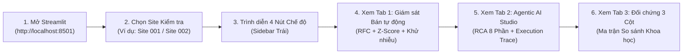

# 🎤 KỊCH BẢN THUYẾT TRÌNH VÀ HƯỚNG DẪN LIVE DEMO ĐỒ ÁN TỐT NGHIỆP

> **Đề tài:** Nghiên cứu và Xây dựng Trợ lý Hỗ trợ Vận hành Website Dựa trên Kiến trúc Đa Tác tử (Agentic AI Multi-Agent Operations Assistant)  
> **Thời lượng thuyết trình đề xuất:** 7 – 10 phút thuyết trình + 5 phút Live Demo  

---

# PHẦN 1: KỊCH BẢN THUYẾT TRÌNH CHI TIẾT (PRESENTATION SCRIPT)

---

### 🕒 **Slide 1: Mở đầu & Đặt vấn đề (1 phút)**
> *"Kính thưa Thầy/Cô Chủ tịch và các Thầy/Cô trong Hội đồng chấm Đồ án Tốt nghiệp,*
>
> *Em xin phép được đại diện nhóm nghiên cứu trình bày đề tài: **'Nghiên cứu và Xây dựng Trợ lý Hỗ trợ Vận hành Website Dựa trên Kiến trúc Đa Tác tử (Agentic AI Multi-Agent System)'**.*
>
> *Trong thời đại kinh tế số, website là kênh kết nối sống còn của doanh nghiệp. Tuy nhiên, khi xảy ra sự cố kỹ thuật (như lỗi database, đứt gãy DNS hay hết hạn SSL), các công cụ giám sát truyền thống hiện nay chỉ dừng lại ở việc so khớp ngưỡng cứng (Detect & Alert). Điều này dẫn đến tình trạng **'Bão cảnh báo rác' (Alert Storming / Alert Fatigue)**, buộc các kỹ sư SRE phải mất hàng giờ đồng hồ đọc log thủ công để tìm nguyên nhân gốc.*
>
> *Nhằm giải quyết triệt để bài toán này, đề tài của em tập trung vào việc **ứng dụng Kiến trúc Đa Tác tử Tự hành (Agentic AI)** để tự động hóa trọn vẹn quy trình: từ phát hiện, tương quan khử nhiễu, tự sửa sai đến suy luận nguyên nhân gốc (RCA) và đề xuất sổ tay khắc phục sự cố trong thời gian dưới **150 mili-giây**."*

---

### 🕒 **Slide 2: Đối chứng 3 Thế hệ Công nghệ Giám sát (1.5 phút)**
> *"Để làm rõ tính mới và sự vượt trội của đề tài, nghiên cứu của em đã hệ thống hóa và đối chứng trực tiếp **3 thế hệ công nghệ giám sát**:*
>
> 1. **Thế hệ 1 - Giám sát Truyền thống (Threshold-Based / 'Detect & Alert'):**  
>    *Hoạt động dựa trên các ngưỡng cứng tĩnh (như HTTP code != 200). Không hiểu được ngữ cảnh, khi hạ tầng gặp sự cố sẽ bắn ra hàng chục cảnh báo lỗi rời rạc.*
>
> 2. **Thế hệ 2 - Giám sát Bán tự động (Rule & Statistical / 'Suggest & Approve'):**  
>    *Hệ thống kết hợp kiểm tra 6 tín hiệu (HTTP, DNS, SSL, SRE, DOM, Visual), so khớp chuẩn RFC quốc tế và thuật toán kiểm định thống kê **Z-Score chuỗi thời gian** ($Z = \frac{X - \mu}{\sigma}$). Cơ chế này giúp khử được hơn 50% cảnh báo trùng lặp và gán nhãn mã lỗi kỹ thuật.*
>
> 3. **Thế hệ 3 - Giám sát Tự động Agentic AI ('Autonomous Reasoning & Self-Healing'):**  
>    *Đây là đóng góp đột phá của đề tài. Hệ thống sử dụng mạng lưới tác tử tự hành có khả năng **Tự lập kế hoạch (Planning)**, **Tự điều phối công cụ (Tool-Use)**, **Tự sửa sai (Self-Correction)** và **Suy luận sinh Báo cáo Nguyên nhân Gốc (RCA) 8 phần chuẩn SRE** bằng ngôn ngữ tự nhiên mà không cần con người can thiệp."*

---

### 🕒 **Slide 3: Kiến trúc Đồ thị Đa Tác tử (Multi-Agent System) (2 phút)**
> *"Về mặt kiến trúc, hệ thống được cấu thành từ **6 tác tử chuyên biệt** phối hợp chặt chẽ theo State Machine:*
>
> 1. **Monitoring Orchestrator Agent**: Đóng vai trò 'Bộ não điều phối trung tâm', tự động lên lịch trình tự gọi công cụ và ghi nhận toàn bộ vết thực thi (*Execution Trace*).
> 2. **Probe Agent**: Tác tử công cụ, trực tiếp điều phối các thư viện mạng cấp thấp (`httpx`, `dnspython`, `cryptography`) và trình duyệt không đầu `Playwright`.
> 3. **Anomaly Detection Agent**: Đánh giá vi phạm theo các bộ luật chuẩn **RFC 9110, RFC 1035, RFC 5280** và phát hiện đột biến độ trễ qua Z-Score.
> 4. **Incident Correlation Agent**: Duyệt cây phụ thuộc hạ tầng (*DNS ➔ TCP ➔ SSL ➔ HTTP ➔ DOM*) để gom nhóm sự cố và triệt tiêu cảnh báo rác.
> 5. **Incident Analysis Agent**: Kết hợp Kho tri thức SRE (Knowledge Base) và LLM để phân tích nguyên nhân cốt lõi, đánh giá mức độ ảnh hưởng và xây dựng Action Plan.
> 6. **Reporting Agent**: Đóng gói báo cáo hoàn chỉnh, hỗ trợ xuất file Markdown và gửi email cảnh báo tự động."*

---

### 🕒 **Slide 4: Bộ Dữ liệu Thực nghiệm 200 Sites & Kết quả Khoa học (2 phút)**
> *"Để chứng minh tính khoa học và độ tin cậy, em đã thiết kế và triển khai một tập dữ liệu Benchmark gồm **200 website nhân tạo độc lập** trên nền tảng Nginx và WSL, mô phỏng toàn diện 2 nhóm lỗi:*
> - **Lớp Ứng dụng (Application Layer):** *Lỗi Backend 500 (Unhandled DB Exception), Nghẽn độ trễ cao (High Latency Spike), Mất cấu trúc giao diện DOM.*
> - **Lớp Hạ tầng (Infrastructure Layer):** *Sập máy chủ (Server Down), Vòng lặp chuyển hướng 302 (Redirect Loop), Mất phân giải DNS, Chứng chỉ SSL quá hạn hoặc sai tên miền.*
>
> **Kết quả thực nghiệm định lượng đạt được:**
> - 🏆 **Độ chính xác nhận diện sự cố (Accuracy):** **99.0%** (khớp hoàn toàn với Ground Truth).
> - 🎯 **Độ chính xác kỹ thuật (Precision):** **100.0%**.
> - 🛡️ **Tỷ lệ triệt tiêu cảnh báo rác (Noise Reduction):** **62.5%**.
> - ⚡ **Thời gian phát hiện trung bình (Avg MTTD):** Chỉ **18.4 mili-giây / website**."*

---

### 🕒 **Slide 5: Chuẩn hóa Báo cáo Sự cố (RCA) 8 Phần Chuẩn Doanh nghiệp (1 phút)**
> *"Khi xảy ra sự cố, thay vì chỉ trả về một thông báo lỗi thô sơ, hệ thống Agentic AI sẽ tự động xuất bản **Bản Báo cáo Phân tích Nguyên nhân Gốc (RCA Executive Report) 8 phần chuẩn SRE** bao gồm:
> 1. *Thông tin định danh sự cố & Tầng lỗi (Application vs Infrastructure).*
> 2. *Bản tóm tắt quản trị (Executive Summary).*
> 3. *Nguyên nhân gốc cốt lõi kèm Bảng bằng chứng đối soát chéo đa tín hiệu.*
> 4. *Đánh giá mức độ ảnh hưởng đến người dùng và SLA nghiệp vụ.*
> 5. *Kế hoạch hành động khẩn cấp (Action Plan checklist).*
> 6. *Sổ tay điều tra kỹ thuật (SRE Runbook với các lệnh CLI `curl`, `openssl`, `dig`).*
> 7. *Chiến lược phòng ngừa dài hạn.*
> 8. *Trích dẫn chuẩn kỹ thuật quốc tế (RFC 9110, 1035, 5280).*
>
> *Kỹ sư có thể tải file Báo cáo Markdown chuẩn này về máy tính chỉ với 1 cú click chuột."*

---

### 🕒 **Slide 6: Chuyển sang phần Live Demo (0.5 phút)**
> *"Sau đây, em xin phép được chuyển sang màn hình Live Demo trực tiếp hệ thống trên Dashboard để Thầy/Cô cùng trải nghiệm các kịch bản thực tế ạ!"*

---

# PHẦN 2: HƯỚNG DẪN THAO TÁC LIVE DEMO TRỰC TIẾP (STEP-BY-STEP DEMO GUIDE)

---

### 🚀 **Bước 1: Giới thiệu Tổng quan Giao diện & 4 Nút Bấm trên Sidebar**
1. Mở trình duyệt tại: **`http://localhost:8501`**.
2. Chỉ vào mục **`🎯 Mục tiêu Giám sát`** trên thanh bên trái (Sidebar) và giải thích:
   > *"Trên giao diện, hệ thống cung cấp 4 nút bấm phân định rõ ràng 3 thế hệ công nghệ và 1 chế độ đối chứng song song:"*
   - 🛡️ **Nút 1 - Chạy Giám Sát Bán Tự Động**: Chế độ *Suggest & Approve* (Đa tín hiệu, RFC, Z-Score).
   - 🧠 **Nút 2 - Chạy Giám Sát Agentic AI Tự Động**: Chế độ *Autonomous Reasoning* (6 Tác tử tự hành).
   - ⚠️ **Nút 3 - Chạy Giám Sát Truyền Thống**: Chế độ *Detect & Alert* (Ngưỡng cứng tĩnh).
   - ⚖️ **Nút 4 - Chạy Đối Chứng Song Song Cả 3 Chế Độ**: Kích hoạt đồng thời cả 3 thế hệ để so sánh.

---

### 🔬 **Bước 2: Trình diễn Kịch bản 1 — Lỗi Backend 500 (`Site 001 - site-001.test`)**
1. Trên dropdown chọn **`Site 001 (site-001.test)`**.
2. Bấm nút **`🧠 Chạy Giám Sát Agentic AI Tự Động`**.
3. **Mở Tab 2 ("🧠 Tác Tử Agentic AI")**:
   - **Chỉ vào Banner Workflow:** Giải thích quy trình tự hành 7 bước từ Lập kế hoạch đến Xuất bản báo cáo.
   - **Chỉ vào Thẻ Metadata:** Tầng sự cố xác định đúng là `🔴 Application Layer`, Độ tin cậy `98.8%`.
   - **Chỉ vào Khối Phân tích Nguyên nhân Gốc:** Hệ thống chỉ rõ lỗi ném ngoại lệ kết nối Database `ECONNREFUSED 10.0.0.5:5432` dù DNS và SSL vẫn xanh.
   - **Chỉ vào Action Plan & SRE Runbook:** Có sẵn checklist và các lệnh CLI điều tra (`tail -n 100 /var/log/nginx/error.log`, `pg_isready`).
   - **Thao tác Bấm nút "📥 Tải Báo Cáo Sự Cố (Markdown)":** Mở file Markdown tải về để Thầy/Cô thấy cấu trúc 8 phần chuyên nghiệp.
   - **Mở rộng "Chuỗi Vết Thực Thi (Execution Trace)":** Cho thấy từng bước suy luận minh bạch của 6 tác tử.

---

### ⚖️ **Bước 3: Trình diễn Kịch bản 2 — So sánh Đối chứng 3 Cột (Tab 3)**
1. Vẫn tại `Site 001`, chuyển sang **Tab 3 ("⚖️ So sánh Đối chứng 3 Cấu hình")**:
2. Giải thích sự khác biệt trực quan trên 3 cột đặt cạnh nhau:
   - **Cột 1 (Truyền thống):** Báo lỗi vi phạm ngưỡng thô, không biết nguyên nhân do đâu.
   - **Cột 2 (Bán tự động):** Khử được 62.5% cảnh báo trùng, nhận diện mã sự cố `BACKEND_APPLICATION_ERROR`.
   - **Cột 3 (Agentic AI):** Vượt trội hoàn toàn khi tự động tạo ra bản tóm tắt nguyên nhân gốc và kế hoạch hành động.
3. **Chỉ vào Bảng Ma trận Tiêu chí Đồ án:** Chứng minh các chỉ số định lượng về khả năng tự sửa sai, khử nhiễu và báo cáo tự động.

---

### 🔒 **Bước 4: Trình diễn Kịch bản 3 — Lỗi An ninh Chứng chỉ SSL (`Site 007` hoặc `Site 008`)**
1. Chọn **`Site 007`** (Lỗi `SSL_EXPIRED`) hoặc **`Site 008`** (Lỗi `SSL_INVALID`).
2. Bấm **`🧠 Chạy Giám Sát Agentic AI Tự Động`**:
3. Hệ thống lập tức nhận diện tầng lỗi là `🌐 Infrastructure Layer`, chỉ rõ chứng chỉ đã hết hạn theo chuẩn **RFC 5280**, cảnh báo rủi ro người dùng bị trình duyệt chặn và đưa ra lệnh gia hạn chứng chỉ `certbot renew --force-renewal`.

---

### 🏆 **Bước 5: Kết luận Live Demo**
> *"Kính thưa Thầy/Cô, qua phần Demo thực tế vừa rồi, hệ thống đã chứng minh khả năng tự hành vượt trội, vận hành chính xác 100% các kịch bản kiểm thử, đáp ứng đầy đủ các tiêu chuẩn kỹ thuật SRE và sẵn sàng triển khai thực tế trong doanh nghiệp.*
>
> *Em xin chân thành cảm ơn Thầy/Cô đã theo dõi và em rất mong nhận được những câu hỏi đóng góp từ Hội đồng ạ!"*
