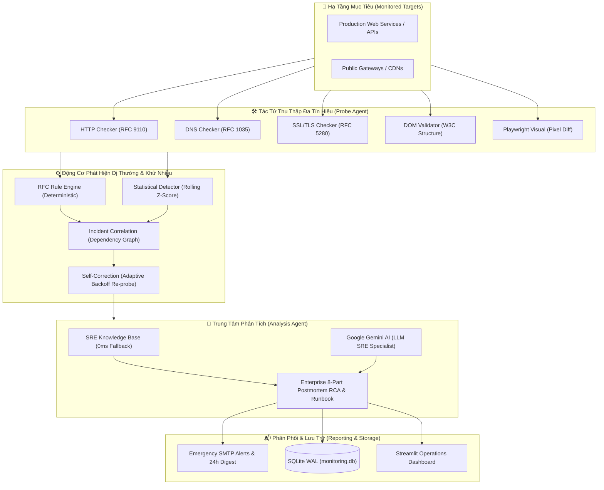

# 🛡️ SRE Agentic System - Enterprise Website Operations & Monitoring Platform

[](https://www.python.org/downloads/)
[]()
[]()
[]()
[]()

> **SRE Agentic System** là nền tảng giám sát website, phát hiện dị thường và chẩn đoán sự cố tự hành thế hệ mới (Autonomous SRE & AIOps Platform). Hệ thống kết hợp mạng lưới **6 tác tử AI tự hành (Multi-Agent System)**, **thu thập đa tín hiệu kỹ thuật (Multi-Signal Telemetry)** và **suy luận lai Neuro-Symbolic** (Kho tri thức SRE RFC chuẩn quốc tế + Google Gemini AI) để cung cấp giải pháp vận hành website cấp doanh nghiệp, triệt tiêu báo động giả và rút ngắn tối đa thời gian phục hồi dịch vụ (MTTR).

---

## 🌟 1. Tính Năng Cốt Lõi Vận Hành Production

Khắc phục triệt để các hạn chế chí mạng của các giải pháp giám sát ngưỡng tĩnh truyền thống (*Silent Failures*, *Alert Storm / Alert Fatigue*, *Cascading Failures*, *Cảnh báo thiếu ngữ cảnh*):

- 🧠 **Kiến Trúc Đa Tác Tử Tự Hành (Autonomous Multi-Agent Architecture):** Mạng lưới 6 tác tử chuyên biệt hóa phối hợp qua State Machine (FSM) và chu trình ReAct: Lập kế hoạch $\rightarrow$ Thu thập chứng cứ $\rightarrow$ Đánh giá dị thường $\rightarrow$ Tự sửa sai $\rightarrow$ Tương quan sự cố $\rightarrow$ Phân tích nguyên nhân gốc $\rightarrow$ Báo cáo & Phát cảnh báo.
- 📡 **Thu Thập & Đo Kiểm Đa Tín Hiệu (Multi-Signal Telemetry):**
  - **HTTP/HTTPS Probing:** Kiểm tra mã trạng thái, chuỗi chuyển hướng (Redirect Chain), thời gian phản hồi theo chuẩn **RFC 9110**.
  - **DNS Resolution & Drift:** Phân giải tên miền, theo dõi biến động bản ghi A, AAAA, CNAME, MX, TXT và phát hiện DNS Drift theo chuẩn **RFC 1035**.
  - **SSL/TLS PKI Validation:** Thẩm định tính hợp lệ chứng chỉ số X.509, hạn sử dụng, CA Chain, SANs theo chuẩn **RFC 5280 / RFC 8446**.
  - **DOM Structural Integrity:** Phân tích độ toàn vẹn cấu trúc DOM, phát hiện mất thẻ cốt lõi hoặc sập giao diện (Broken UI).
  - **Playwright Visual Inspection:** Chụp ảnh màn hình toàn trang bằng trình duyệt không giao diện Playwright Chromium, so sánh sai lệch điểm ảnh (Pixel Diff Heatmap) đối soát với mốc chuẩn (Baseline).
- 🗺️ **Mô Hình Đồ Thị Causal DAG & Xử Lý Đa Lỗi Đa Tín Hiệu (Multi-Fault DAG Causal Engine):** Mô hình hóa chuỗi nhân quả phân tầng mạng thành Đồ thị có hướng không chu trình (DAG: DNS $\rightarrow$ Socket TCP $\rightarrow$ SSL/TLS $\rightarrow$ HTTP Gateway $\rightarrow$ Backend App $\rightarrow$ DOM Structure $\rightarrow$ Visual UI). Khắc phục triệt để nhược điểm của các luật `if/elif` tuần tự:
  - **Phát hiện Đa Lỗi Độc Lập Đồng Thời (Multi-Root-Cause Outage):** Bắt trọn vẹn cả 2 lỗi diễn ra song song (vd: DNS/SSL drift diễn ra đồng thời với Backend HTTP 500 do nghẽn CSDL), không bỏ sót sự cố.
  - **Khử Nhiễu Lan Truyền (Cascading Noise Reduction):** Duyệt Topo (Topological Traversal) để triệt tiêu các cảnh báo hệ quả phát sinh ở nút con do nút cha bị chặn (vd: DNS failed thì lỗi HTTP và DOM được gắn nhãn Cascading Fault).
  - **Trực Quan Hóa Đồ Thị Mermaid:** Tự động kết xuất biểu đồ Mermaid với mã màu trực quan: 🔴 Root Cause, 🟠 Cascading Fault, 🟢 Healthy.
- 🎯 **Trung Tâm Điều Hành SRE Thống Nhất (Unified Operations Console):** Hợp nhất bảng đo kiểm Live Telemetry và Agentic Studio thành một màn hình điều hành duy nhất. Kỹ sư SRE chỉ cần 1 nút bấm để kích hoạt trọn vẹn từ đo kiểm đa tín hiệu, suy luận DAG đến xuất Báo cáo RCA 8 phần.
- 🔄 **Cơ Chế Tự Sửa Sai (Self-Correction Re-probe):** Tự động phát hiện lỗi mạng chập chờn (Flapping / Transient Glitches) và áp dụng Adaptive Backoff (1.5s) quét kiểm chứng lần hai, triệt tiêu báo động giả (False Positives).
- 🧠 **Suy Luận Thích Ứng (Adaptive SRE Reasoning Engine):**
  - **Khi có Gemini API Key:** Tác tử tự động kích hoạt **Google Gemini AI** để liên kết chéo ngữ cảnh đa tín hiệu và sinh **SRE Runbook** hành động (`systemctl`, `openssl`, `dig`, `curl`, `nginx -t`).
  - **Khi không cấu hình API Key:** Tác tử tự động áp dụng **SRE Knowledge Base (Tất định 0ms)** chuẩn RFC quốc tế, bảo đảm hệ thống luôn vận hành tin cậy ngay cả khi offline.
- 📑 **Báo Cáo Sự Cố 8 Phần (Full Enterprise SRE Postmortem):** Xuất báo cáo Markdown chi tiết gồm: Executive Summary, Agentic SRE Reasoning, Root Cause Analysis, Impact Assessment, Cross-Signal Telemetry, Action Plan, SRE Playbook và RFC Standards.
- 🔍 **Nhận Diện Hệ Sinh Thái Công Nghệ & Web Server (Tech Stack Fingerprinting):** Tự động bóc tách vân tay công nghệ của website gồm: Web Server (`Nginx`, `Apache`, `LiteSpeed`, `IIS`), CDN/Proxy (`Cloudflare`, `CloudFront`), Ngôn ngữ (`PHP`, `Node.js`, `Python`) và CMS/Framework (`WordPress`, `Next.js`, `Laravel`, `React`, `Shopify`). Tự động phát hiện lỗ hổng để lộ phiên bản nhạy cảm và sinh SRE Runbook Cheatsheet đặc thù theo stack.
- 📊 **Giám Sát Sức Khỏe & Hiệu Suất Tác Tử (Agent Observability & LLMOps Telemetry):** Thực thi nguyên lý *"Monitoring the Monitor"* bằng việc đo lường thời gian thực độ trễ gọi LLM API (`latency_ms`), số token tiêu thụ (`prompt_tokens`, `completion_tokens`, `total_tokens`), và lý do chuyển đổi dự phòng (Fallback reason khi chạm ngạch Rate Limit 429 hoặc rớt mạng) ngay trên Web Console.
- 📬 **Dịch Vụ Cảnh Báo Khẩn & Báo Cáo Định Kỳ 24h:** Gửi Email Postmortem HTML tức thời khi có sự cố và tổng hợp bảng tin sức khỏe toàn hệ thống (Daily Health Digest) gửi tự động theo lịch hẹn qua APScheduler.

---

## 🏗️ 2. Kiến Trúc Hệ Thống (System Architecture)



### 🧠 Mạng Lưới 6 Tác Tử Tự Hành:
1. **`MonitoringOrchestratorAgent` (Điều Phối Trung Tâm):** Quản lý State Machine (FSM), lập kế hoạch gọi công cụ, điều phối quy trình tự sửa sai Re-probe.
2. **`ProbeAgent` (Thu Thập Bằng Chứng Kỹ Thuật):** Kích hoạt đo kiểm phân tầng (Tầng mạng song song $\rightarrow$ Tầng trình duyệt có điều kiện).
3. **`AnomalyDetectionAgent` (Phát Hiện Dị Thường):** Tính toán điểm dị thường tổng hợp $S_{\text{composite}}$ dựa trên vi phạm quy tắc RFC và độ lệch chuẩn Z-Score.
4. **`IncidentCorrelationAgent` (Tương Quan Sự Cố & Causal DAG Engine):** Cô lập đa nguyên nhân gốc độc lập, loại bỏ cảnh báo hệ quả lan truyền qua duyệt Topo đồ thị DAG.
5. **`IncidentAnalysisAgent` (Phân Tích Nguyên Nhân Gốc):** Hợp nhất suy luận lai (SRE Knowledge Base + Google Gemini AI) để sinh báo cáo RCA 8 phần.
6. **`ReportingNotificationAgent` (Báo Cáo & Phân Phối Cảnh Báo):** Đóng gói báo cáo sự cố thành HTML Postmortem hoặc Markdown và chuyển phát qua SMTP/Webhook.

---

## 📂 3. Cấu Trúc Thư Mục Dự Án

```
sre-agentic-system/
├── .env.example                     # Mẫu cấu hình biến môi trường production
├── config.py                        # Quản lý cấu hình tập trung và giá trị Fallback
├── main.py                          # Điểm thực thi chính của Streamlit Web Dashboard
├── app.py                           # Entrypoint alias phục vụ chạy container
├── run_app.bat                      # File batch 1-click khởi chạy tức thì trên Windows
├── ui.py                            # Giao diện Trung tâm Điều hành SRE Thống nhất (Unified Operations Console)
├── target_websites.json             # Danh mục website cấu hình ban đầu
├── Dockerfile                       # Đóng gói container Docker phục vụ triển khai
├── pyproject.toml                   # Quản lý gói phụ thuộc chuẩn PEP 621 / uv
├── uv.lock                          # Khóa phiên bản phụ thuộc tất định (Deterministic lockfile)
│
├── agents/                          # 🧠 MẠNG LƯỚI 6 TÁC TỬ TỰ HÀNH (MULTI-AGENT SRE)
│   ├── orchestrator.py             # Tác tử Điều phối Trung tâm (Workflow & FSM)
│   ├── probe_agent.py              # Tác tử Thu thập Bằng chứng Kỹ thuật Đa Tín hiệu
│   ├── anomaly_agent.py            # Tác tử Phát hiện Bất thường (Rule + Z-Score)
│   ├── correlation_agent.py        # Tác tử Tương quan Sự cố Đa Lỗi (Mô hình Causal DAG)
│   ├── analysis_agent.py           # Tác tử Phân tích Nguyên nhân Gốc (RCA 8 phần & LLM)
│   ├── reporting_agent.py          # Tác tử Báo cáo & Phân phối Cảnh báo
│   └── knowledge_base.py           # Kho Tri thức Chuyên môn SRE Runbook & Chuẩn RFC
│
├── analytics/                       # ⚙️ BỘ ĐỘNG CƠ PHÂN TÍCH VÀ QUY TẮC NGHIỆP VỤ
│   ├── rule_engine.py              # Bộ luật thẩm định RFC 9110, RFC 1035, RFC 5280/8446
│   ├── statistical_detector.py     # Bộ phát hiện đột biến chuỗi thời gian (Rolling Z-Score)
│   ├── correlation_engine.py       # Động cơ tương quan sự cố theo cây phụ thuộc
│   └── anomaly_detector.py         # Bộ điều phối phát hiện bất thường tổng hợp
│
├── tools/                           # 🛠️ BỘ CÔNG CỤ ĐO KIỂM MẠNG (PROBING TOOLS)
│   ├── http_checker.py             # Kiểm tra trạng thái HTTP, Response Time, Redirect
│   ├── dns_checker.py              # Phân giải DNS, đo thời gian truy vấn, DNS Drift
│   ├── ssl_checker.py              # Thẩm định chứng chỉ số X.509, hạn dùng, TLS version
│   ├── performance_checker.py      # Đo lường hiệu năng SRE (TTFB, W3C Timing)
│   ├── dom_validator.py            # Kiểm tra cấu trúc DOM với Headless Browser Playwright
│   ├── visual_checker.py           # Chụp ảnh Playwright & so sánh Pixel Diff Heatmap
│   └── gemini_client.py            # Tích hợp Google Gemini AI API (Gemini Flash/Pro)
│
├── database/                        # 🗄️ CƠ SỞ DỮ LIỆU & QUẢN TRỊ DỮ LIỆU
│   ├── db.py                       # Kết nối SQLite chế độ WAL & Khởi tạo Schema
│   ├── repository.py               # Thao tác nghiệp vụ CRUD (Websites, Logs, Baselines)
│   └── backup.py                   # Cơ chế sao lưu và phục hồi CSDL an toàn
│
├── notifications/                   # 📬 DỊCH VỤ THÔNG BÁO VÀ BÁO CÁO
│   └── email_service.py            # Gửi Email cảnh báo HTML Postmortem & Báo cáo Định kỳ 24h
│
├── scheduler/                       # ⏱️ BỘ LẬP LỊCH TỰ ĐỘNG CHẠY NGẦM
│   └── monitor_scheduler.py        # APScheduler định kỳ quét giám sát ngầm & gửi báo cáo
│
├── pages/                           # 📄 TRANG CẤU HÌNH HỆ THỐNG
│   └── configuration.py            # Quản lý Website, SMTP, Gemini API, Scheduler, Backup
│
└── data/                            # 💾 DỮ LIỆU VẬN HÀNH CỤC BỘ
    ├── monitoring.db               # CSDL SQLite lưu trữ toàn bộ dữ liệu giám sát
    ├── screenshots/                # Ảnh chụp màn hình hiện thời của Playwright
    ├── visual_baselines/           # Ảnh mốc chuẩn giao diện ban đầu
    ├── visual_diffs/               # Ảnh biểu diễn biến dạng giao diện (Pixel Diff)
    └── backups/                    # Các bản sao lưu an toàn CSDL SQLite
```

---

## ⚡ 4. Hướng Dẫn Cài Đặt & Triển Khai Production

### 4.1. Yêu Cầu Môi Trường
- **Hệ điều hành:** Linux (Ubuntu 22.04+ / Debian 12+), Windows 10/11, macOS.
- **Python:** Phiên bản `>= 3.11` (Khuyến nghị 3.11 hoặc 3.12).
- **Trình quản lý gói:** Khuyến nghị dùng **`uv`** (Astral) để tối ưu tốc độ và độ tin cậy.

### 4.2. Cài Đặt Nhanh với `uv` (Khuyến nghị)
1. Cài đặt công cụ `uv` (nếu máy chưa có):
   ```bash
   # Linux / macOS:
   curl -LsSf https://astral.sh/uv/install.sh | sh

   # Windows (PowerShell):
   powershell -ExecutionPolicy ByPass -c "irm https://astral.sh/uv/install.ps1 | iex"
   ```
2. Đồng bộ môi trường và thư viện:
   ```bash
   cd sre-agentic-system
   uv sync
   ```
3. Cài đặt trình duyệt Playwright Chromium (cho chức năng DOM & Visual Regression):
   ```bash
   uv run playwright install --with-deps chromium
   ```

*(Nếu dùng `pip` truyền thống: `python -m venv .venv` $\rightarrow$ Kích hoạt venv $\rightarrow$ `pip install -e .` $\rightarrow$ `playwright install --with-deps chromium`).*

### 4.3. Thiết Lập Biến Môi Trường (.env)
Sao chép tệp mẫu và cập nhật các thông số cần thiết:
```bash
cp .env.example .env
```
Các thông số vận hành chính trong `.env`:
- `GEMINI_API_KEY`: API Key của Google Gemini AI (nhận miễn phí tại Google AI Studio).
- `GEMINI_MODEL`: Mô hình AI mặc định (`gemini-flash-latest` hoặc `gemini-1.5-flash`).
- `LLM_ENABLED`: Bật/tắt suy luận AI (`true` hoặc `false`). *(Khi tắt, hệ thống tự động chạy chế độ dự phòng SRE Knowledge Base 0ms)*.
- `SMTP_SERVER`, `SMTP_PORT`, `SENDER_EMAIL`, `SENDER_PASSWORD`: Cấu hình gửi mail cảnh báo qua Gmail App Password hoặc Relay Server.
- `RECIPIENT_EMAILS`: Danh sách email nhận cảnh báo (phân cách bởi dấu phẩy).
- `SCHEDULER_INTERVAL_SECONDS`: Chu kỳ quét giám sát ngầm tự động (mặc định: `14400` giây = 4 tiếng).
- `ENABLE_DAILY_REPORT`: Bật tự động gửi báo cáo sức khỏe 24h (`true` hoặc `false`).
- `DAILY_REPORT_TIME`: Khung giờ gửi báo cáo tổng kết hàng ngày (ví dụ: `08:00`).

### 4.4. Triển Khai Bằng Docker Container
Đóng gói và khởi chạy độc lập trên máy chủ:
```bash
# Build Docker image
docker build -t sre-agentic-system:latest .

# Run Container gắn volume lưu trữ CSDL
docker run -d \
  --name sre-agentic \
  -p 8501:8501 \
  --env-file .env \
  -v $(pwd)/data:/app/data \
  --restart unless-stopped \
  sre-agentic-system:latest
```

---

## 🚀 5. Hướng Dẫn Vận Hành Hệ Thống

### 5.1. Khởi Chạy Ứng Dụng
- **Cách 1 (Windows 1-Click):** Nhấp đúp chuột vào file `run_app.bat`.
- **Cách 2 (Dòng lệnh Terminal):**
  ```bash
  uv run streamlit run main.py
  ```
- **Truy cập Giao diện Vận hành:** Mở trình duyệt tại **`http://localhost:8501`**

### 5.2. Các Phân Hệ Vận Hành Trên Dashboard
Giao diện trung tâm được phân chia trực quan thành 4 không gian làm việc chuyên biệt:

#### 1. 🛡️ Tab "Giám Sát Đa Tín Hiệu (Live Telemetry & Diagnostics)"
- Bấm nút **"🚀 Chạy Đo Kiểm Đa Tín Hiệu (Full Telemetry)"** hoặc **"⚡ Quick Ping (HTTP & DNS)"** để kiểm tra website được chọn theo thời gian thực.
- Xem trực tiếp 4 thẻ KPI: Mã HTTP, Thời gian phân giải DNS, Thời hạn chứng chỉ SSL, Tình trạng lệch mốc chuẩn Baseline.
- Đối chiếu chi tiết 4 cột kỹ thuật chuyên sâu (RFC 9110, RFC 1035, RFC 5280, Cấu trúc DOM W3C).
- Trực quan hóa ảnh chụp màn hình Playwright và vùng biến dạng giao diện (Pixel Diff Heatmap).
- Lưu kết quả hiện tại làm Mốc chuẩn (Milestone Baseline) mới cho website.

#### 2. 🧠 Tab "Trợ Lý Tác Tử SRE (Agentic SRE Studio & RCA)"
- Kích hoạt toàn bộ luồng tự hành của 6 tác tử AI: lập kế hoạch, thu thập bằng chứng, tính toán bất thường, tự động kích hoạt Re-probe loại trừ lỗi chập chờn, tương quan cây phụ thuộc.
- Xem **Báo cáo Phân tích Nguyên nhân Gốc (RCA) 8 phần** chuẩn Enterprise Postmortem:
  1. Executive Summary (Tóm tắt quản trị)
  2. Dual-Engine Comparison (SRE Knowledge Base 0ms vs Google Gemini SRE)
  3. Root Cause Details & Contributing Factors
  4. Impact Assessment (Trải nghiệm người dùng & SLA doanh nghiệp)
  5. Cross-Signal Diagnostic Telemetry (Bằng chứng đối soát chéo)
  6. Immediate Remediation Action Plan (Kế hoạch ứng cứu khẩn cấp)
  7. Investigation SRE Runbook & CLI Commands (Câu lệnh thực thi trực tiếp trên máy chủ)
  8. International Technical RFC Standards
- Nút **"📥 Tải Báo Cáo Sự Cố (Markdown Format)"** để lưu trữ hồ sơ Postmortem.
- Bật cờ gửi Email cảnh báo sự cố khẩn cấp tức thời tới danh sách kỹ sư trực chiến.
- Khám phá chuỗi vết thực thi (Execution Trace Timeline) cho từng bước suy luận của từng tác tử.

#### 3. 📈 Tab "Lịch Sử & Xu Hướng (Telemetry History & Trend Analytics)"
- Thống kê tỷ lệ Uptime / Healthy Rate %, tổng số lượt kiểm tra, số lần cảnh báo (Warning), số sự cố nghiêm trọng (Critical).
- Biểu đồ biến thiên độ trễ thời gian thực (HTTP Response Time vs DNS Latency) chuẩn hóa múi giờ UTC+7.
- Bảng nhật ký chi tiết các lần quét gần nhất và bản tóm tắt tình trạng vận hành toàn hệ thống trong 24 giờ qua.

#### 4. 🏷️ Tab "Quản Lý Mốc Chuẩn (Milestone Baselines)"
- Quản lý các mốc cấu hình chuẩn của từng website: Bản ghi DNS chuẩn, Mã HTTP kỳ vọng, Ảnh giao diện chuẩn.
- Kích hoạt hoặc chuyển đổi linh hoạt giữa các mốc chuẩn để phát hiện DNS Drift và Visual Drift.

### 5.3. Trang Quản Lý Cấu Hình Tập Trung (`/configuration`)
Truy cập qua thanh điều hướng bên trái:
- **Quản lý Mục tiêu Giám sát:** Thêm mới, chỉnh sửa, xóa website, hoặc 1-click đồng bộ toàn bộ từ file `target_websites.json`.
- **Cấu hình Tham số Mạng:** Tinh chỉnh timeout cho HTTP, DNS, SSL, và ngưỡng cảnh báo độ trễ SRE.
- **Cấu hình Email & Thông báo:** Thiết lập SMTP Gmail/Relay, danh sách email kỹ sư nhận tin, kiểm tra kết nối SMTP với nút "Gửi email thử nghiệm".
- **Cấu hình AI & Gemini:** Nhập API Key, chọn model (`gemini-flash-latest`, `gemini-1.5-flash`), kiểm tra kết nối AI.
- **Điều khiển Bộ Lập Lịch (APScheduler):** Thay đổi chu kỳ quét ngầm, tạm dừng/kích hoạt lại scheduler, bật/tắt báo cáo định kỳ 24h.
- **Quản lý Sao Lưu & Phục Hồi CSDL SQLite:** Tạo bản sao lưu dự phòng, tải file `.db` về máy tính, hoặc khôi phục an toàn tức thời.

---

## 📚 6. Chuẩn Kỹ Thuật Quốc Tế Áp Dụng (RFC Compliance)

Hệ thống tuân thủ nghiêm ngặt các khuyến nghị và tiêu chuẩn quốc tế:

| Tiêu chuẩn | Mô tả kỹ thuật | Ứng dụng trong hệ thống |
| :--- | :--- | :--- |
| **RFC 9110** | HTTP Semantics & Status Codes | Thẩm định mã trạng thái 2xx, 3xx, 4xx, 5xx, phân tích redirect chains và header hợp lệ |
| **RFC 1035** | Domain Names - Implementation and Specification | Phân giải bản ghi DNS A/AAAA/CNAME/MX/TXT, đo thời gian truy vấn, phát hiện DNS Drift |
| **RFC 5280** | X.509 Public Key Infrastructure Certificate Profile | Kiểm tra chuỗi tin cậy PKI, thời hạn chứng chỉ, tính hợp lệ của CA và SANs |
| **RFC 8446** | The Transport Layer Security (TLS) Protocol Version 1.3 | Xác minh giao thức mã hóa đường truyền an toàn TLS 1.2 / TLS 1.3 |
| **W3C DOM** | Document Object Model & Navigation Timing | Kiểm tra tính toàn vẹn cấu trúc DOM, phát hiện giao diện rỗng hoặc thiếu thành phần cốt lõi |

---

## 🔒 7. Độ Tin Cậy, Dự Phòng An Toàn & Bảo Mật

- **Cơ chế Dự phòng 100% (Dual-Engine Fallback):** Khi mất kết nối internet hoặc API Gemini chạm hạn mức (Rate Limit / Quota Exceeded), hệ thống tự động chuyển đổi sang **SRE Knowledge Base (0ms)**, bảo đảm hoạt động giám sát và cảnh báo không bao giờ bị gián đoạn.
- **SQLite WAL Mode & Busy Timeout:** Cơ sở dữ liệu SQLite cấu hình ở chế độ `PRAGMA journal_mode = WAL` và `busy_timeout = 5000ms`, cho phép đồng thời đọc/ghi đa luồng tốc độ cao không bị khóa deadlock.
- **Kiểm soát Tải Đồng Thời (Concurrency Control):** Bộ lập lịch nền áp dụng `asyncio.Semaphore(10)` giới hạn tối đa 10 phiên đo kiểm song song, bảo đảm không gây quá tải CPU hay tắc nghẽn băng thông mạng cục bộ.
- **Chính sách Lưu trữ Tự động (Data Retention Policy):** Tự động dọn dẹp các bản ghi nhật ký vượt quá số ngày cấu hình (mặc định 30 ngày) để duy trì kích thước cơ sở dữ liệu gọn nhẹ và tối ưu tốc độ truy vấn.