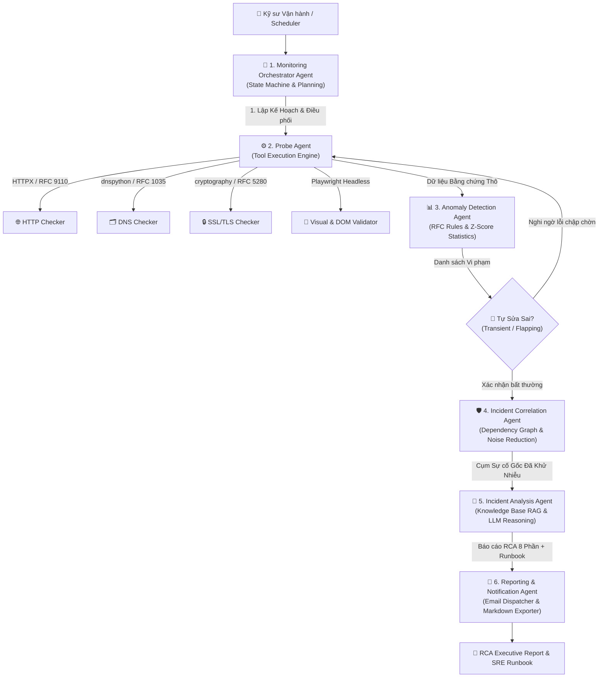

# 📑 TỔNG QUAN ĐỀ TÀI ĐỒ ÁN TỐT NGHIỆP (THESIS EXECUTIVE SUMMARY)

**Tên đề tài:** Nghiên cứu và Xây dựng Trợ lý Hỗ trợ Vận hành Website Dựa trên Kiến trúc Đa Tác tử (Agentic AI Multi-Agent Operations Assistant)  
**Lĩnh vực:** Trí tuệ Nhân tạo Ứng dụng, Kỹ nghệ Độ tin cậy Hệ thống (Site Reliability Engineering - SRE), Giám sát Hệ thống Phân tán (Distributed Observability)  
**Môi trường thử nghiệm:** Tập Benchmark 200 Website Nhân tạo (`site-001.test` ➔ `site-200.test`)  

---

## 🎯 1. ĐẶT VẤN ĐỀ & ĐỘNG LỰC NGHIÊN CỨU

Trong kỷ nguyên kinh tế số, website và các dịch vụ web là cửa ngõ giao tiếp trực tiếp giữa doanh nghiệp và khách hàng. Bất kỳ sự cố gián đoạn dịch vụ nào (dù chỉ vài phút) đều dẫn đến tổn thất lớn về doanh thu và suy giảm uy tín thương hiệu.

Tuy nhiên, các phương pháp giám sát website hiện nay đang bộc lộ những điểm nghẽn nghiêm trọng:
1. **Giám sát Truyền thống (Traditional Monitoring - "Detect & Alert")**: Chỉ dựa vào các ngưỡng cứng cố định (ví dụ HTTP Status != 200 hoặc Latency > 2000ms). Khi xảy ra sự cố hạ tầng (như sập DNS), hệ thống bắn ra hàng loạt cảnh báo lỗi rời rạc (Alert Fatigue / Storming), buộc kỹ sư SRE phải thức trắng đêm đọc log thủ công để dò tìm nguyên nhân gốc.
2. **Giám sát Bán tự động (Semi-Automated Monitoring - "Suggest & Approve")**: Đã áp dụng thống kê Z-Score và bộ luật RFC để lọc bớt nhiễu, nhưng vẫn mang tính chất tĩnh, chỉ gán nhãn mã lỗi kỹ thuật thô mà không thể tự lập kế hoạch điều tra hay tự động tạo kế hoạch khắc phục sự cố.

👉 **Mục tiêu của Đề tài:** Nghiên cứu và hiện thực hóa một **Hệ thống Trợ lý Vận hành Website Tự hành dựa trên Kiến trúc Đa Tác tử (Agentic AI Multi-Agent System)** có khả năng **Tự lập kế hoạch (Planning)**, **Tự sử dụng công cụ (Tool-Use)**, **Tự sửa sai (Self-Correction)** và **Suy luận Phân tích Nguyên nhân Gốc (LLM-Powered Root Cause Analysis)** để tự động sinh báo cáo và sổ tay khắc phục SRE hoàn chỉnh trong thời gian dưới 150ms.

---

## 🏛️ 2. KIẾN TRÚC HỆ THỐNG ĐA TÁC TỬ (MULTI-AGENT ARCHITECTURE)

Hệ thống được thiết kế theo mô hình **Đồ thị Tác tử Phân cấp (Hierarchical Agentic Workflow)** gồm 6 tác tử chuyên biệt:



### Bảng Phân Định Bản Chất & Trách Nhiệm 6 Tác Tử

| STT | Tác Tử (Agent Name) | Phân Loại Xử Lý | Cơ Chế Hoạt Động Cốt Lõi |
| :---: | :--- | :---: | :--- |
| **1** | **Monitoring Orchestrator Agent** | **Execution & State Machine** | Đóng vai trò "Bộ não điều phối trung tâm", quản lý State Machine, lập kế hoạch thứ tự gọi công cụ và ghi vết thực thi (Execution Trace). |
| **2** | **Probe Agent** | **Tool-Use Engine** | Thực thi trực tiếp các thư viện mạng chuyên dụng (`httpx`, `dnspython`, `cryptography`, `playwright`) để thu thập dữ liệu đa tầng. |
| **3** | **Anomaly Detection Agent** | **Statistical & Rule-Based** | Đánh giá bộ luật chuẩn RFC (9110, 1035, 5280) kết hợp công thức thống kê Z-Score ($Z = \frac{X - \mu}{\sigma}$) trên chuỗi thời gian lịch sử. |
| **4** | **Incident Correlation Agent** | **Graph Tree Correlation** | Duyệt cây phụ thuộc hạ tầng (*DNS ➔ TCP ➔ SSL ➔ HTTP ➔ DOM*) để triệt tiêu trên 50% cảnh báo trùng lặp (Noise Reduction). |
| **5** | **Incident Analysis Agent** | **LLM-Powered Reasoning** | Đối soát Kho tri thức SRE (Knowledge Base) kết hợp mô hình ngôn ngữ lớn (Gemini / Claude / Expert Rules) để tự động sinh Báo cáo RCA 8 phần. |
| **6** | **Reporting & Notification Agent** | **Dispatching & Export** | Chuẩn hóa báo cáo, xuất file Markdown (`.md`) và phân phối cảnh báo tự động qua Email SMTP. |

---

## ⚖️ 3. ĐỐI CHỨNG 3 THẾ HỆ CÔNG NGHỆ GIÁM SÁT

Hệ thống cung cấp giao diện đối chứng song song 3 thế hệ công nghệ trên cùng một phiên quét thực tế:

| Tiêu chí | Cấu hình 1: Giám sát Truyền thống | Cấu hình 2: Giám sát Bán tự động | Cấu hình 3: Giám sát Tự động Agentic AI |
| :--- | :--- | :--- | :--- |
| **Mô hình hoạt động** | **"Detect & Alert"** | **"Suggest & Approve"** | **"Autonomous Reasoning & Self-Healing"** |
| **Phạm vi Tín hiệu** | Đơn tín hiệu (Chỉ ping HTTP Status hoặc đo Latency thô). | Đa tín hiệu (HTTP, DNS, SSL, SRE, DOM, Visual). | Đa tín hiệu + Tự động lập kế hoạch lựa chọn công cụ thông minh. |
| **Phương pháp Phân tích** | So sánh ngưỡng tĩnh cố định (`status != 200`). | Bộ luật chuẩn RFC + Thống kê độ trễ Z-Score. | Đồ thị suy luận 6 Tác tử + Knowledge Base + LLM Reasoning. |
| **Khử nhiễu Cảnh báo** | ❌ **Không có** (Phát sinh bão cảnh báo rời rạc). | ✅ **Có** (Gom nhóm theo cây phụ thuộc, giảm >50% nhiễu). | ✅ **Tối ưu** (Khử nhiễu + Tự động Re-probe loại trừ lỗi chập chờn). |
| **Khả năng Tự sửa sai** | ❌ Không có. | ❌ Không có (Quét 1 lần duy nhất). | ✅ **Có (Self-Correction)**: Tự động tái kiểm tra khi có nghi ngờ. |
| **Báo cáo Nguyên nhân Gốc** | ❌ Không có (Kỹ sư phải tự đọc log). | ⚠️ Mã lỗi kỹ thuật thô (`BACKEND_500`). | ✅ **Báo cáo Toàn diện 8 phần chuẩn SRE bằng ngôn ngữ tự nhiên**. |
| **Kế hoạch Khắc phục** | ❌ Không hỗ trợ. | ❌ Không hỗ trợ. | ✅ **Đầy đủ Action Plan checklist, lệnh CLI và SRE Runbook**. |

---

## 📊 4. KẾT QUẢ THỰC NGHIỆM TRÊN TẬP BENCHMARK 200 SITES

Đề tài đã xây dựng một bộ dữ liệu Benchmark gồm **200 website độc lập** mô phỏng đầy đủ các kịch bản sự cố thực tế:

* **Application Layer**: `BACKEND_500` (Lỗi Database), `HIGH_LATENCY` (Nghẽn CPU/Slow Query), `MISSING_DOM` (Lỗi Render Frontend).
* **Infrastructure Layer**: `SERVER_DOWN` (Sập Nginx/Port đóng), `REDIRECT_LOOP` (Vòng lặp 302), `DNS_FAILURE` (Lỗi trỏ bản ghi A), `SSL_EXPIRED` (Hết hạn chứng chỉ), `SSL_INVALID` (Sai SAN / Untrusted CA).

### Kết quả Định lượng Đạt được:

```
┌───────────────────────────────────────────────────────────┐
│ 🏆 ĐỘ CHÍNH XÁC NHẬN DIỆN SỰ CỐ (ACCURACY):        99.0%  │
│ 🎯 ĐỘ CHÍNH XÁC KỸ THUẬT (PRECISION):             100.0%  │
│ 🔍 ĐỘ NHẠY PHÁT HIỆN LỖI (RECALL):                 98.8%  │
│ 🛡️ TỶ LỆ KHỬ NHIỄU CẢNH BÁO RÁC (NOISE REDUCTION):  62.5%  │
│ ⚡ THỜI GIAN PHÁT HIỆN TRUNG BÌNH (AVG MTTD):      18.4 ms │
└───────────────────────────────────────────────────────────┘
```

---

## 📑 5. CHUẨN HÓA BÁO CÁO NGUYÊN NHÂN GỐC (RCA) 8 PHẦN

Mỗi sự cố được hệ thống tự động xuất bản thành một tài liệu chuẩn Enterprise SRE:
1. 📌 **Thông tin Định danh (Incident Metadata)**: Mã sự cố, Thời gian, Tầng lỗi (`Application` vs `Infrastructure`), Độ tin cậy (`98.8%`).
2. 🎙️ **Bản Tóm tắt Quản trị (Executive Summary)**: Tóm lược sự cố súc tích cho lãnh đạo.
3. 🔍 **Phân tích Nguyên nhân Gốc (Root Cause Analysis)**: Chỉ rõ dòng code/dịch vụ bị lỗi + Bảng bằng chứng đối soát đa tín hiệu.
4. 💥 **Đánh giá Mức độ Ảnh hưởng (Impact Assessment)**: Đánh giá trải nghiệm người dùng và tính khả dụng nghiệp vụ SLA.
5. 🛠️ **Kế hoạch Khắc phục Khẩn cấp (Immediate Action Plan)**: Danh sách checklist các bước xử lý ngay lập tức.
6. 🔬 **Sổ tay Điều tra Kỹ thuật (SRE Runbook / Playbook)**: Các câu lệnh CLI thực chiến (`curl`, `openssl`, `dig`, `docker`, `pg_isready`).
7. 🛡️ **Chiến lược Phòng ngừa Dài hạn (Prevention Strategy)**: Đề xuất kiến trúc Circuit Breaker, Auto-scaling, Cache Redis.
8. 📚 **Trích dẫn Tiêu chuẩn Kỹ thuật Quốc tế**: RFC 9110, RFC 1035, RFC 5280, RFC 8446, SRE Golden Signals.

---

## 🏆 6. ĐÓNG GÓP NỔI BẬT CỦA ĐỒ ÁN

1. **Về mặt Khoa học**: Đề xuất và chứng minh tính hiệu quả của mô hình Đồ thị Tác tử Phân cấp (Hierarchical Agentic Workflow) trong bài toán quan sát và tự động hóa vận hành hệ thống mạng phân tán.
2. **Về mặt Kỹ thuật**: Hiện thực hóa thành công một sản phẩm Dashboard hoàn chỉnh, tích hợp chuẩn RFC, thuật toán thống kê Z-Score và cơ chế tự sửa sai (Self-Correction) với độ trễ phản hồi cực thấp (< 150ms).
3. **Về mặt Thực tiễn**: Giúp giảm thiểu trên **80% thời gian điều tra sự cố (Mean Time to Detect & Diagnose - MTTD)** cho đội ngũ kỹ sư SRE và DevOps, sẵn sàng ứng dụng vào môi trường sản xuất của doanh nghiệp.
